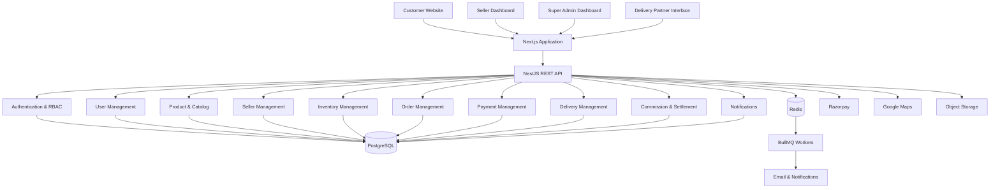
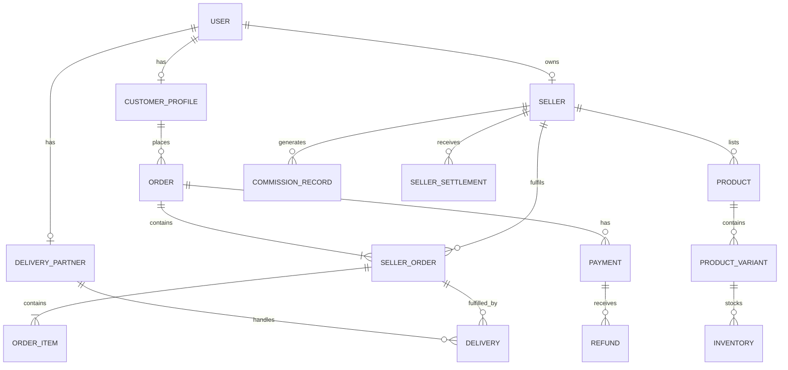
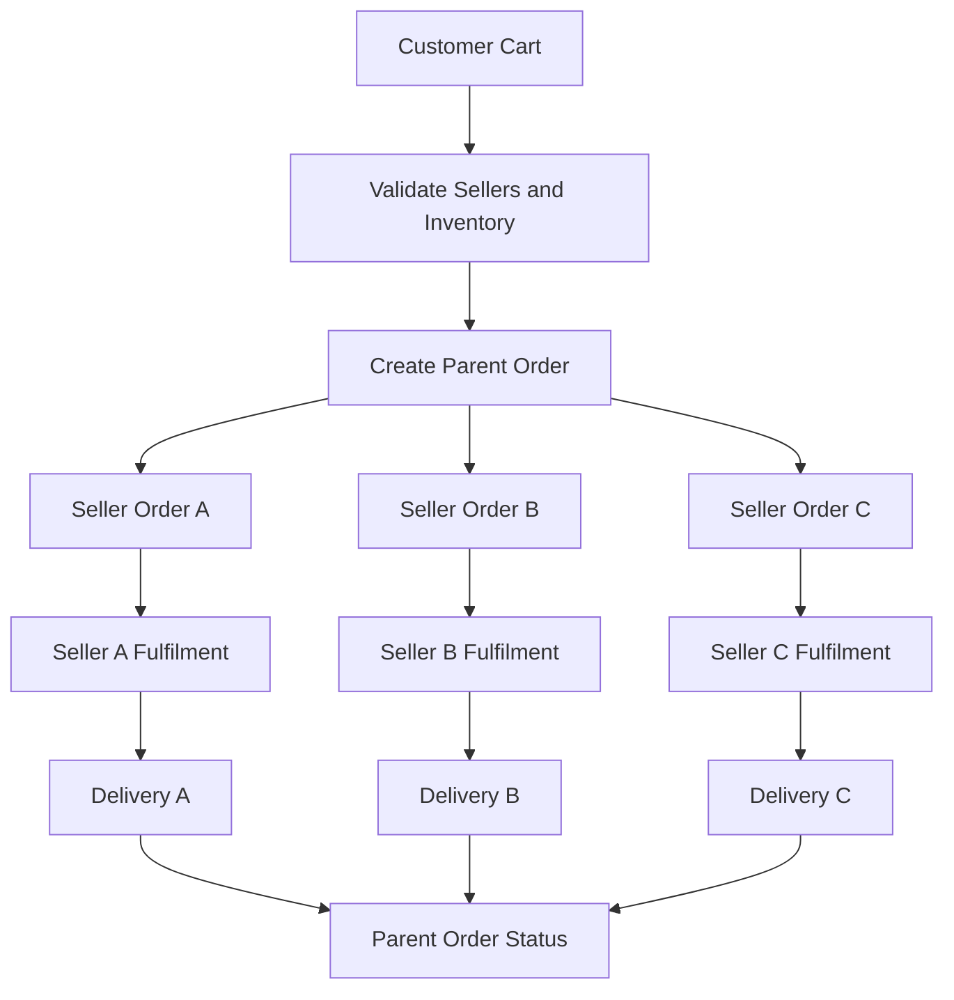
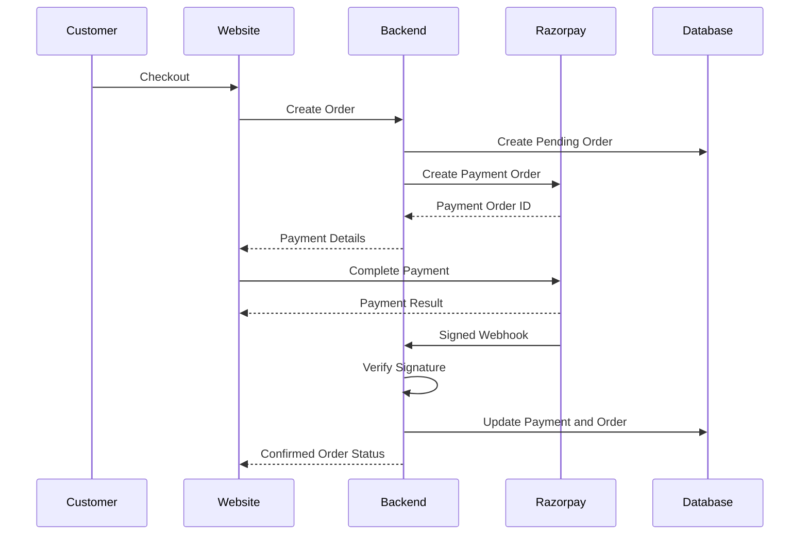

# MARVEL'S BASKET
## Complete Technical Architecture & Development Roadmap

**Project ID:** MB/MT/2026/001  
**Client:** Marvel's Basket  
**Development Company:** Marvel's Techworks  
**Document Version:** 1.0  
**Status:** Architecture Planning  
**Date:** 19 November 2026

---

# 1. PROJECT VISION

Marvel's Basket is a multi-vendor grocery and daily-essentials marketplace designed to connect customers with multiple local grocery stores, supermarkets and independent sellers.

The platform will provide:

- Customer-facing e-commerce website.
- Multi-vendor seller management system.
- Super Admin management portal.
- Delivery partner interface.
- Location-based product and seller discovery.
- Seller-specific inventory and order management.
- Integrated payment and financial management.
- Scalable backend APIs for future mobile applications.

### Primary objectives

1. Build a production-ready marketplace.
2. Support multiple independent sellers.
3. Support multiple sellers operating within the same delivery area.
4. Maintain independent inventory and fulfilment workflows.
5. Provide reliable order, payment and delivery management.
6. Design reusable APIs for future mobile applications.
7. Maintain security, performance and scalability.

---

# 2. APPROVED TECHNOLOGY STACK

| Layer | Technology |
|---|---|
| Frontend | Next.js + TypeScript |
| Frontend Styling | Tailwind CSS |
| UI Components | shadcn/ui |
| Backend | NestJS + TypeScript |
| API Architecture | REST API |
| Database | PostgreSQL |
| ORM | Prisma |
| Validation | Zod / class-validator |
| API Documentation | Swagger / OpenAPI |
| Authentication | JWT + Refresh Tokens |
| Authorization | Role-Based Access Control |
| State Management | Zustand / TanStack Query |
| Form Management | React Hook Form + Zod |
| Caching | Redis |
| Background Jobs | BullMQ |
| Payment Gateway | Razorpay |
| Maps & Location | Google Maps API |
| File Storage | S3-compatible object storage |
| Email | Resend |
| Testing | Jest + Supertest + Playwright |
| Package Manager | pnpm |
| Monorepo | pnpm Workspaces + Turborepo |
| Version Control | Git + GitHub |

### Additional infrastructure recommendations

- Docker for local development and reproducible environments.
- Redis for caching, rate limiting and background jobs.
- PostgreSQL PostGIS extension for advanced geographic queries.
- Sentry or equivalent for error monitoring.
- Cloud hosting with automated backups and monitoring.

These additional services are architectural recommendations, not confirmed client requirements. Their providers and recurring costs must be approved before adoption.

---

# 3. SYSTEM ARCHITECTURE

## 3.1 High-level architecture



## 3.2 Architectural approach

Use a modular monolith architecture.

The backend will initially run as one NestJS application with independent business modules.

Each module must have:

- Defined responsibilities.
- Independent service logic.
- Clear database ownership boundaries.
- Well-defined internal interfaces.
- Unit and integration tests.

Do not introduce microservices during initial development.

This approach reduces infrastructure complexity while retaining the ability to scale individual modules later.

## 3.3 Application architecture

One Next.js application will provide all four web interfaces.

Suggested route groups:

```text
/
├── (storefront)/
│   ├── /
│   ├── /categories
│   ├── /products
│   ├── /sellers
│   ├── /cart
│   ├── /checkout
│   ├── /orders
│   └── /account
│
├── (seller)/
│   └── /seller/
│       ├── dashboard
│       ├── products
│       ├── inventory
│       ├── orders
│       ├── earnings
│       ├── settlements
│       └── settings
│
├── (admin)/
│   └── /admin/
│       ├── dashboard
│       ├── customers
│       ├── sellers
│       ├── products
│       ├── categories
│       ├── orders
│       ├── payments
│       ├── commissions
│       ├── settlements
│       ├── deliveries
│       ├── offers
│       └── reports
│
└── (delivery)/
    └── /delivery/
        ├── dashboard
        ├── deliveries
        ├── earnings
        ├── history
        └── profile
```

All role-based access must also be enforced by the backend. Hiding frontend routes is not sufficient authorization.

---

# 4. MONOREPO PROJECT STRUCTURE

Repository name: `marvels-basket`

```text
marvels-basket/
│
├── apps/
│   │
│   ├── web/
│   │   ├── public/
│   │   ├── src/
│   │   │   ├── app/
│   │   │   ├── components/
│   │   │   ├── features/
│   │   │   ├── hooks/
│   │   │   ├── lib/
│   │   │   ├── services/
│   │   │   ├── stores/
│   │   │   ├── types/
│   │   │   └── styles/
│   │   ├── tests/
│   │   └── package.json
│   │
│   └── api/
│       ├── src/
│       │   ├── main.ts
│       │   ├── app.module.ts
│       │   │
│       │   ├── common/
│       │   ├── config/
│       │   ├── database/
│       │   │
│       │   ├── modules/
│       │   │   ├── auth/
│       │   │   ├── users/
│       │   │   ├── customers/
│       │   │   ├── sellers/
│       │   │   ├── products/
│       │   │   ├── categories/
│       │   │   ├── inventory/
│       │   │   ├── carts/
│       │   │   ├── orders/
│       │   │   ├── payments/
│       │   │   ├── commissions/
│       │   │   ├── settlements/
│       │   │   ├── deliveries/
│       │   │   ├── locations/
│       │   │   ├── reviews/
│       │   │   ├── offers/
│       │   │   ├── notifications/
│       │   │   ├── reports/
│       │   │   └── admin/
│       │   │
│       │   └── jobs/
│       ├── prisma/
│       │   ├── schema.prisma
│       │   ├── migrations/
│       │   └── seed.ts
│       ├── test/
│       └── package.json
│
├── packages/
│   ├── shared-types/
│   ├── shared-validation/
│   ├── eslint-config/
│   ├── typescript-config/
│   └── utils/
│
├── docs/
│   ├── PROJECT_CONTEXT.md
│   ├── PROJECT_REQUIREMENTS.md
│   ├── TECHNICAL_ARCHITECTURE.md
│   ├── DATABASE_SCHEMA.md
│   ├── API_DOCUMENTATION.md
│   ├── PROJECT_STATUS.md
│   ├── PROJECT_DECISIONS.md
│   └── IMPLEMENTATION_PHASES.md
│
├── scripts/
├── docker/
├── .github/
├── docker-compose.yml
├── pnpm-workspace.yaml
├── turbo.json
├── package.json
├── .env.example
├── .gitignore
└── README.md
```

### Monorepo principles

- `apps/web`: Complete frontend application.
- `apps/api`: Backend application and database integration.
- `packages/shared-types`: Shared TypeScript types.
- `packages/shared-validation`: Reusable validation schemas.
- `packages/utils`: Shared business-independent utilities.
- `docs`: Project documentation.

Do not import backend implementation code directly into the frontend.

Shared packages must contain only genuinely reusable code.

---

# 5. USER ROLES AND PERMISSIONS

The initial platform will support four primary user categories.

| Role | Main responsibilities |
|---|---|
| CUSTOMER | Shopping, payments and orders |
| SELLER | Shop, products, inventory and fulfilment |
| ADMIN | Complete platform management |
| DELIVERY_PARTNER | Assigned deliveries and delivery status |

Additional system-level roles may be introduced:

- SUPER_ADMIN
- SUPPORT_AGENT
- FINANCE_MANAGER

These additional roles require business approval.

### Permission examples

CUSTOMER:
- Manage personal profile.
- Manage delivery addresses.
- Browse products.
- Place orders.
- Make payments.
- Cancel eligible orders.
- Submit reviews.

SELLER:
- Manage shop profile.
- Manage own products.
- Update own inventory.
- Accept or reject orders.
- Process seller orders.
- View own earnings.
- View settlement history.

ADMIN:
- Manage all sellers and customers.
- Approve or suspend sellers.
- Manage products and categories.
- Manage orders and refunds.
- Configure commissions.
- Configure delivery areas.
- Manage offers and banners.
- Access platform reports.

DELIVERY_PARTNER:
- Manage delivery profile.
- View assigned deliveries.
- Accept eligible assignments.
- Update pickup and delivery statuses.
- View delivery history and earnings.

**Security rule:** Every seller-owned resource must be checked against the authenticated seller's ID. Never trust seller IDs supplied by frontend requests.

---

# 6. DATABASE ARCHITECTURE

Database: PostgreSQL  
ORM: Prisma

The database will use a relational structure with foreign keys, appropriate unique constraints, indexes and transactions.

## 6.1 Core database entities

### A. Authentication and users

- User
- Role
- Permission
- UserRole
- RefreshToken
- UserSession
- VerificationToken

### B. Customer management

- CustomerProfile
- CustomerAddress
- CustomerPreference
- Wishlist
- WishlistItem

### C. Seller management

- Seller
- SellerProfile
- SellerDocument
- SellerVerification
- SellerAddress
- SellerBusinessHours
- SellerServiceArea

### D. Product management

- Category
- Product
- ProductVariant
- ProductImage
- ProductAttribute
- ProductAttributeValue
- ProductCategory
- ProductOffer

### E. Inventory management

- Inventory
- InventoryTransaction
- StockReservation
- StockAdjustment

Inventory must be maintained separately for each seller and product variant.

### F. Shopping cart

- Cart
- CartItem
- CartSellerGroup (optional derived representation)

### G. Order management

- Order
- SellerOrder
- OrderItem
- OrderStatusHistory
- OrderCancellation
- OrderReturn
- OrderAddressSnapshot

### H. Payment management

- Payment
- PaymentTransaction
- PaymentWebhookEvent
- Refund
- PaymentMethod

### I. Commission and settlement

- CommissionRule
- CommissionRecord
- SellerEarning
- SellerSettlement
- SettlementItem
- PayoutTransaction

### J. Delivery management

- DeliveryPartner
- DeliveryAssignment
- Delivery
- DeliveryStatusHistory
- DeliveryLocation
- DeliveryZone

### K. Platform management

- Banner
- Coupon
- CouponUsage
- Review
- Notification
- SupportTicket
- AuditLog
- SystemSetting

## 6.2 Important database relationships



This is a conceptual relationship diagram. The final Prisma schema will determine exact cardinalities and constraints.

## 6.3 Critical database design decisions

**Money**

- Use PostgreSQL Decimal types.
- Never use floating-point arithmetic for financial calculations.
- Store currency explicitly.
- Maintain immutable financial transaction records.

**Inventory**

- Maintain inventory per seller and product variant.
- Use database transactions for stock reservation.
- Prevent negative inventory through transactional validation and database constraints.
- Maintain stock movement history.

**Orders**

- Preserve product name, SKU, price, quantity and tax details at purchase time.
- Preserve delivery and seller address snapshots where necessary.
- Do not depend on current product information to reconstruct historical orders.

**Financial records**

- Store commission calculations against the applicable commission rule.
- Maintain seller earnings separately from customer payment records.
- Maintain a complete audit trail for refunds and settlements.

---

# 7. MULTI-VENDOR ORDER ARCHITECTURE

This is one of the most important parts of Marvel's Basket.

A single customer cart may contain products from multiple sellers.

Example:

Customer purchases:

| Seller | Products | Amount |
|---|---|---:|
| Seller A | Rice + Milk | ₹350 |
| Seller B | Fruits + Vegetables | ₹250 |
| Seller C | Snacks | ₹150 |
| Total | | ₹750 |

The platform must create:

- One parent customer order.
- Three independent seller orders.
- Separate seller inventory reservations.
- Independent seller fulfilment workflows.
- Separate delivery assignments where required.



### Order processing principles

1. Validate product availability.
2. Validate seller serviceability.
3. Validate applicable delivery charges.
4. Calculate individual seller subtotals.
5. Calculate platform-level charges and discounts.
6. Reserve inventory transactionally.
7. Create parent and seller orders.
8. Initiate payment.
9. Confirm payment using a verified gateway response.
10. Notify the respective sellers.
11. Track seller-level fulfilment.
12. Update the overall customer order.

### Important edge cases

- One seller rejects an order.
- One seller runs out of stock.
- Payment succeeds but order processing fails.
- Payment fails after stock reservation.
- One seller cancels while other sellers fulfil.
- One delivery is completed while another is pending.
- Customer requests a partial refund.
- One seller's delivery is delayed.

The parent order status must be derived from seller-order states and payment state. It must not overwrite individual seller-order history.

---

# 8. PAYMENT AND FINANCIAL ARCHITECTURE

Payment gateway: Razorpay (subject to account readiness and approval).

### Payment flow



### Supported payment methods

- UPI
- Debit cards
- Credit cards
- Net banking
- Cash on Delivery, where enabled

### Financial modules

1. Payment processing.
2. Payment verification.
3. Refund processing.
4. Order-wise commission calculation.
5. Seller earnings.
6. Settlement history.
7. Platform revenue reporting.
8. Transaction reconciliation.

### Marketplace commission example

Assume:

- Seller product value: ₹1,000
- Platform commission: 10%
- Commission: ₹100
- Seller's gross earning before other agreed deductions: ₹900

Actual calculations must account for applicable taxes, discounts, refunds and contractual deductions.

### Important payment decisions

- Never trust the frontend payment-success callback.
- Verify Razorpay webhook signatures.
- Implement webhook idempotency.
- Maintain unique gateway transaction references.
- Keep payment and order statuses separate.
- Support partial refunds.
- Maintain an auditable financial ledger.

Automated split settlement must not be assumed. Razorpay Route or another approved marketplace payout solution should be evaluated separately, subject to provider approval, compliance and commercial agreement.

---

# 9. LOCATION AND QUICK-COMMERCE ARCHITECTURE

The platform must discover sellers and products according to customer serviceability.

### Initial location workflow

1. Customer enters PIN code or selects an address.
2. Backend resolves the service area.
3. Platform identifies eligible sellers.
4. Seller operating status is checked.
5. Product availability is checked per seller.
6. Delivery charge is calculated.
7. Estimated delivery time is calculated.
8. Only serviceable sellers and products are shown.

### Recommended location architecture

- PIN-code-based serviceability for the initial implementation.
- Configurable seller delivery zones.
- Optional geographic coordinates.
- PostgreSQL PostGIS for radius-based discovery.
- Google Maps for address and distance services.

### Delivery configuration

Each seller may have:

- Delivery radius.
- Supported PIN codes.
- Operating hours.
- Minimum order value.
- Delivery charge.
- Estimated preparation time.
- Maximum order capacity.

### Delivery time estimation

Estimated delivery time should consider:

- Seller preparation time.
- Distance.
- Delivery partner availability.
- Current operational load.
- Local delivery conditions.

The 10–30-minute proposition is an operational target, not a guaranteed software capability.

---

# 10. SECURITY ARCHITECTURE

Security must be implemented from the beginning.

### Authentication

- Secure login and registration.
- Short-lived access tokens.
- Rotating refresh tokens.
- Secure password hashing.
- Session management.
- Logout and token revocation.

### Authorization

- Role-based access control.
- Permission-based backend guards.
- Resource ownership validation.
- Seller data isolation.
- Admin action authorization.

### Application security

- Input validation.
- SQL injection prevention through Prisma's safe query APIs.
- XSS protection.
- CSRF protection where applicable.
- Rate limiting.
- Secure HTTP headers.
- CORS restrictions.
- File upload validation.
- Secrets management.

### Payment security

- Server-side payment verification.
- Signed webhook verification.
- Idempotency.
- Refund authorization.
- Financial audit logs.

### Data security

- Encrypted network communication.
- Secure credential storage.
- Database backup and recovery.
- Restricted database access.
- Sensitive data minimization.
- Retention and deletion policies.

All customer and seller information must be handled according to applicable Indian data protection requirements.

---

# 11. API ARCHITECTURE

Base URL:

`/api/v1`

### Authentication

```text
POST   /auth/register
POST   /auth/login
POST   /auth/refresh
POST   /auth/logout
POST   /auth/forgot-password
POST   /auth/reset-password
```

### Customer

```text
GET    /customers/me
PATCH  /customers/me
GET    /customers/addresses
POST   /customers/addresses
PATCH  /customers/addresses/:id
DELETE /customers/addresses/:id
```

### Products

```text
GET    /products
GET    /products/:id
GET    /categories
GET    /categories/:id/products
GET    /sellers/:id/products
```

### Sellers

```text
POST   /sellers/register
GET    /sellers/me
PATCH  /sellers/me
GET    /sellers/me/orders
GET    /sellers/me/earnings
GET    /sellers/me/settlements
```

### Inventory

```text
GET    /inventory
POST   /inventory
PATCH  /inventory/:id
GET    /inventory/transactions
```

### Cart and checkout

```text
GET    /cart
POST   /cart/items
PATCH  /cart/items/:id
DELETE /cart/items/:id
POST   /checkout/validate
POST   /checkout
```

### Orders

```text
GET    /orders
GET    /orders/:id
POST   /orders
POST   /orders/:id/cancel
GET    /orders/:id/tracking
```

### Payments

```text
POST   /payments/create
POST   /payments/verify
POST   /payments/webhook
POST   /payments/:id/refund
GET    /payments/:id
```

### Delivery

```text
GET    /delivery/assignments
POST   /delivery/assignments/:id/accept
PATCH  /delivery/:id/status
GET    /delivery/history
```

### Admin

```text
GET    /admin/dashboard
GET    /admin/users
GET    /admin/sellers
PATCH  /admin/sellers/:id/status
GET    /admin/orders
GET    /admin/reports
GET    /admin/settlements
```

The above endpoints are proposed API contracts. Final request/response schemas and permissions will be defined during implementation.

---

# 12. BACKGROUND JOBS AND NOTIFICATIONS

Redis + BullMQ is recommended for asynchronous tasks.

### Background jobs

- Order confirmation emails.
- Seller order notifications.
- Delivery assignment notifications.
- Payment reconciliation.
- Refund status synchronization.
- Settlement processing.
- Inventory reservation expiry.
- Scheduled reports.
- Abandoned cart notifications.

### Notification channels

Initial:
- Email.
- In-app notifications.

Future:
- SMS.
- WhatsApp.
- Push notifications.

Important: Background jobs must be retryable and idempotent. Redis must not become the source of truth for orders, inventory or financial records.

---

# 13. FRONTEND DESIGN SYSTEM

Brand direction from the work order:

| Design element | Direction |
|---|---|
| Primary | Dark Green |
| Accent | Bright Lime Green |
| Background | White / Light Grey |
| Typography | Modern and readable |
| Layout | Modular cards |
| Responsive | Mobile-first |
| Interface | Clean and accessible |

### Suggested design tokens

```css
:root {
  --brand-primary: #075B36;
  --brand-dark: #03452A;
  --brand-accent: #A7E52E;

  --background: #FFFFFF;
  --surface: #F6F8F5;

  --foreground: #17251C;
  --muted: #6B786F;

  --border: #E2E9E3;
  --success: #16833D;
  --danger: #DC3545;
}
```

### Frontend principles

- Consistent design system.
- Reusable UI components.
- Responsive layouts.
- Accessible forms.
- Loading and empty states.
- Proper error handling.
- Optimized product images.
- SEO-friendly storefront pages.
- Independent dashboard layouts.

The supplied website mockup is a visual direction, not a final approved implementation specification.

---

# 14. DEPLOYMENT AND INFRASTRUCTURE

### Environment strategy

Maintain three environments:

1. Development
2. Staging
3. Production

### Proposed infrastructure

| Component | Responsibility |
|---|---|
| Web hosting | Next.js deployment |
| API hosting | NestJS deployment |
| PostgreSQL | Primary relational database |
| Redis | Cache and job queues |
| Object storage | Product and seller images |
| Domain | Marvel's Basket domain |
| SSL | HTTPS |
| Monitoring | Error and uptime monitoring |
| Backups | Database recovery |

### Domain structure

Proposed:

```text
marvelsbasket.in
www.marvelsbasket.in
api.marvelsbasket.in
```

Dashboard routes can initially remain inside the main website.

### CI/CD

GitHub Actions should handle:

1. Code formatting.
2. Linting.
3. Type checking.
4. Unit tests.
5. Integration tests.
6. Production build.
7. Deployment after approval.

Database migrations must be reviewed and applied through a controlled deployment process.

Never use destructive schema synchronization as a production migration strategy.

---

# 15. TESTING STRATEGY

### Unit testing

- Business calculations.
- Commission calculation.
- Inventory operations.
- Order status transitions.
- Delivery charge calculations.
- Permission checks.

### Integration testing

- Authentication.
- Database operations.
- Seller onboarding.
- Product management.
- Inventory reservation.
- Multi-vendor order creation.
- Payment processing.
- Refunds.
- Delivery assignment.

### End-to-end testing

- Customer registration.
- Product discovery.
- Add to cart.
- Checkout.
- Payment.
- Seller order acceptance.
- Delivery assignment.
- Order completion.
- Cancellation and refund.

### Security testing

- Unauthorized API access.
- Cross-seller data access.
- Privilege escalation.
- Webhook forgery.
- Rate-limit enforcement.
- Input validation.
- Sensitive data exposure.

### Performance testing

- Product listing.
- Search.
- Checkout.
- Concurrent stock reservations.
- Order creation.
- Dashboard analytics.

No critical or high-severity unresolved security issues should remain at production launch.

---

# 16. PHASE-WISE IMPLEMENTATION ROADMAP

## PHASE 00 — Project Foundation & Planning

Objectives:
- Finalize architecture.
- Establish project documentation.
- Define scope and exclusions.
- Finalize infrastructure requirements.
- Establish development workflow.

Deliverables:
- Project context.
- Requirements document.
- Technical architecture.
- Implementation roadmap.
- Initial GitHub repository.
- Development standards.

Completion criteria:
- Architecture approved.
- Project scope documented.
- Development environment requirements finalized.

## PHASE 01 — Monorepo & Infrastructure Setup

Objectives:
- Initialize pnpm monorepo.
- Configure Turborepo.
- Initialize Next.js.
- Initialize NestJS.
- Configure PostgreSQL and Prisma.
- Configure Docker development environment.
- Set up environment management.

Deliverables:
- Working monorepo.
- Web application.
- API application.
- Database connection.
- Prisma migrations.
- Shared packages.
- Basic CI pipeline.

Completion criteria:
- Both applications run independently.
- Database connection works.
- CI checks pass.

## PHASE 02 — Database Foundation & Authentication

Objectives:
- Design initial Prisma schema.
- Implement user management.
- Implement registration and login.
- Implement access and refresh tokens.
- Implement RBAC.
- Implement account management.

Deliverables:
- Authentication APIs.
- User management.
- Role and permission system.
- Session management.
- Protected routes.
- Authentication UI.

Completion criteria:
- All initial roles authenticate correctly.
- Unauthorized access is rejected.
- Refresh and logout workflows work.

## PHASE 03 — Design System & Frontend Foundation

Objectives:
- Build Marvel's Basket design system.
- Develop common layouts.
- Create responsive navigation.
- Create reusable UI components.
- Establish API integration and state management.

Deliverables:
- Storefront layout.
- Seller dashboard layout.
- Admin dashboard layout.
- Delivery dashboard layout.
- Responsive component library.

Completion criteria:
- All four interfaces have consistent layouts.
- Mobile and desktop responsiveness is verified.

## PHASE 04 — Seller Onboarding & Management

Objectives:
- Seller registration.
- Business profile management.
- KYC document submission.
- Admin seller verification.
- Seller approval and suspension.
- Seller service area configuration.

Deliverables:
- Seller registration workflow.
- Seller dashboard foundation.
- Admin seller management.
- Verification records.
- Seller status management.

Completion criteria:
- Sellers can register.
- Admins can approve or reject sellers.
- Suspended sellers cannot conduct marketplace operations.

## PHASE 05 — Product Catalog & Inventory

Objectives:
- Category management.
- Product management.
- Product variants.
- Product image management.
- Seller-specific pricing.
- Inventory tracking.
- Stock adjustment history.

Deliverables:
- Product CRUD APIs.
- Seller product dashboard.
- Admin catalog management.
- Inventory management.
- Product listing pages.

Completion criteria:
- Each seller manages only their own products.
- Inventory remains seller-specific.
- Stock updates are auditable.

## PHASE 06 — Customer Storefront & Shopping Cart

Objectives:
- Homepage.
- Product listing.
- Product details.
- Categories.
- Search and filters.
- Seller discovery.
- Wishlist.
- Shopping cart.

Deliverables:
- Complete customer storefront.
- Product discovery.
- Search and filtering.
- Seller pages.
- Cart management.

Completion criteria:
- Customers can browse and manage their carts.
- Cart items retain seller associations.
- Unavailable products are handled correctly.

## PHASE 07 — Location & Serviceability

Objectives:
- PIN-code serviceability.
- Customer address management.
- Seller delivery zones.
- Location-based seller discovery.
- Delivery fee calculation.
- Estimated delivery time.

Deliverables:
- Location APIs.
- Serviceability engine.
- Seller delivery configuration.
- Address selection.
- Serviceability UI.

Completion criteria:
- Non-serviceable sellers are excluded.
- Delivery rules are enforced during checkout.

## PHASE 08 — Multi-Vendor Checkout & Order Management

Objectives:
- Checkout validation.
- Parent order creation.
- Seller order splitting.
- Inventory reservation.
- Seller order acceptance.
- Order status management.
- Cancellation workflows.

Deliverables:
- Checkout APIs.
- Order management module.
- Seller-specific order dashboard.
- Customer order history.
- Order status timeline.

Completion criteria:
- Multi-seller orders work correctly.
- Inventory cannot be oversold through concurrent checkouts.
- Partial seller cancellation is supported.

## PHASE 09 — Payment & Financial Management

Objectives:
- Razorpay integration.
- UPI/card/net banking.
- COD.
- Payment verification.
- Webhook processing.
- Refund management.
- Commission calculations.
- Seller earnings.
- Settlement records.

Deliverables:
- Payment integration.
- Refund workflows.
- Financial ledger.
- Commission engine.
- Seller earnings dashboard.
- Admin financial dashboard.

Completion criteria:
- Payment records reconcile with gateway events.
- Duplicate webhooks do not create duplicate financial operations.
- Refunds are traceable.
- Settlement records are auditable.

## PHASE 10 — Delivery Partner Management

Objectives:
- Delivery partner registration.
- Verification.
- Assignment management.
- Assignment acceptance.
- Pickup confirmation.
- Delivery status updates.
- Delivery history.
- Earnings records.

Deliverables:
- Delivery partner interface.
- Delivery management APIs.
- Admin assignment management.
- Customer tracking.
- Delivery history.

Completion criteria:
- Delivery assignments follow valid state transitions.
- Delivery partners access only authorized assignments.
- Customer tracking reflects actual delivery status.

## PHASE 11 — Admin Dashboard & Business Analytics

Objectives:
- Platform overview.
- Seller analytics.
- Customer analytics.
- Order analytics.
- Revenue reports.
- Commission reports.
- Settlement reports.
- Offers and banners.
- User and role management.
- Audit logs.

Deliverables:
- Complete Super Admin dashboard.
- Reports and analytics.
- Platform configuration.
- Promotion management.
- Administrative audit trail.

Completion criteria:
- Reports use actual database data.
- Sensitive admin actions are recorded.
- Role restrictions are enforced.

## PHASE 12 — Notifications & Automation

Objectives:
- Email notifications.
- Order notifications.
- Seller notifications.
- Delivery notifications.
- Refund notifications.
- Background jobs.
- Retry and failure handling.

Deliverables:
- Notification module.
- BullMQ workers.
- Email templates.
- Notification history.
- Job monitoring.

Completion criteria:
- Important events trigger appropriate notifications.
- Failed jobs can be retried safely.
- Duplicate notifications are controlled.

## PHASE 13 — Complete Testing & Security Audit

Objectives:
- Unit testing.
- API integration testing.
- End-to-end testing.
- Payment testing.
- Multi-vendor workflow testing.
- Responsive testing.
- Security testing.
- Performance testing.
- Backup recovery testing.

Deliverables:
- Test reports.
- Security audit.
- Bug tracking report.
- Performance report.
- UAT checklist.

Completion criteria:
- Critical workflows pass.
- No unresolved critical or high-severity security issues.
- Payment and order reconciliation verified.
- Client UAT approved.

## PHASE 14 — Production Deployment & Handover

Objectives:
- Production infrastructure setup.
- Domain and SSL configuration.
- Database migration.
- Production deployment.
- Monitoring configuration.
- Backup verification.
- Admin training.
- Documentation handover.

Deliverables:
- Production website.
- Production backend APIs.
- Production database.
- Deployment documentation.
- API documentation.
- Source code handover.
- Admin training.
- Known limitations report.

Completion criteria:
- Production smoke tests pass.
- Backups are verified.
- Monitoring is active.
- Client acceptance is documented.

---

# 17. FUTURE EXPANSION ROADMAP

The backend must be designed for future applications.

### Future Phase A — Android Customer Application

- Customer login.
- Product browsing.
- Shopping cart.
- Checkout.
- Order tracking.
- Push notifications.

### Future Phase B — iOS Customer Application

- Reuse existing backend APIs.
- Native iOS interface.
- Customer shopping experience.
- Push notifications.

### Future Phase C — Dedicated Seller Application

- Seller dashboard.
- Inventory management.
- Order processing.
- Sales and earnings.

### Future Phase D — Dedicated Delivery Application

- Delivery assignments.
- Location sharing.
- Pickup and delivery updates.
- Earnings and history.

### Future Phase E — Advanced Quick-Commerce

- Real-time delivery partner location.
- Advanced seller discovery.
- Smart delivery assignment.
- Delivery capacity management.
- Demand forecasting.
- Advanced inventory analytics.

These are future expansion possibilities, not part of the current website delivery commitment.

---

# 18. PROJECT MILESTONES

| Milestone | Completion gate |
|---|---|
| M1 | Foundation and architecture |
| M2 | Authentication and design system |
| M3 | Seller onboarding and product management |
| M4 | Customer storefront and inventory |
| M5 | Location and multi-vendor checkout |
| M6 | Payments and financial management |
| M7 | Delivery partner management |
| M8 | Admin analytics and notifications |
| M9 | Testing and UAT |
| M10 | Production deployment and handover |

Actual dates and commercial estimates will be finalized separately with the client.

---

# 19. IMPORTANT BUSINESS DECISIONS TO FINALIZE

The work order describes the expected capabilities but does not define all operational and commercial rules.

The following must be confirmed before the corresponding implementation phases.

1. Seller commission: Fixed percentage, category-wise or seller-specific?
2. Payment settlement: Manual settlement or approved automated marketplace payouts?
3. Delivery model: Seller-managed delivery, platform-managed delivery or both?
4. Delivery charges: Fixed, distance-based, seller-based or order-value-based?
5. Delivery coverage: PIN-code zones or configurable geographic radius?
6. Order splitting: Can individual seller orders be cancelled independently?
7. Refund policy: Full refunds, partial refunds and cancellation rules?
8. COD: Which sellers, locations and order values support COD?
9. Seller KYC: Which documents and verification process are required?
10. Tax and invoices: Applicable GST, invoice responsibility and accounting rules?
11. Product catalogue: Can multiple sellers sell the same standardized product?
12. Promotions: Platform-funded discounts, seller-funded discounts or both?
13. Search: Basic database search or dedicated search infrastructure?
14. Delivery partners: Independent registration, admin assignment or automated assignment?
15. Operations: Who manages customer support and delivery disputes?

These decisions must be documented in PROJECT_DECISIONS.md.

---

# 20. DEVELOPMENT RULES & ENGINEERING STANDARDS

All implementation must follow these rules:

### Code quality
- TypeScript strict mode.
- Consistent ESLint and Prettier configuration.
- Reusable modules and components.
- No unnecessary code duplication.
- No uncontrolled `any` types.
- No hardcoded credentials.

### Backend
- Modular NestJS architecture.
- DTO validation.
- Consistent API responses.
- Centralized exception handling.
- Database transactions for critical operations.
- Swagger documentation.
- Role and resource-level authorization.

### Frontend
- Feature-based organization.
- Reusable components.
- Proper loading, error and empty states.
- Accessible interfaces.
- Responsive layouts.
- Strong API typing.

### Database
- Prisma migrations.
- Foreign key constraints.
- Appropriate indexes.
- Transaction-safe financial and inventory operations.
- No direct production schema modifications.

### Git workflow
- `main`: Production-ready code.
- `develop`: Integration branch.
- `feature/*`: Feature development.
- `fix/*`: Bug fixes.
- Pull requests for integration.
- No direct unreviewed production commits.

### Documentation
Every completed phase must update:
- PROJECT_STATUS.md
- PROJECT_DECISIONS.md
- API_DOCUMENTATION.md where relevant.
- DATABASE_SCHEMA.md where relevant.

---

# 21. FINAL ARCHITECTURAL DECISIONS

| Area | Decision |
|---|---|
| Application architecture | Modular monolith |
| Repository | Monorepo |
| Frontend | Next.js + TypeScript |
| Backend | NestJS |
| Database | PostgreSQL |
| ORM | Prisma |
| API | REST |
| API versioning | `/api/v1` |
| Authentication | JWT + Refresh Tokens |
| Authorization | RBAC |
| Payments | Razorpay |
| Cache | Redis |
| Background jobs | BullMQ |
| Maps | Google Maps |
| Testing | Jest + Supertest + Playwright |
| Deployment | Separate web and API services |
| Mobile readiness | API-first architecture |

---

# 22. DEFINITION OF PROJECT COMPLETION

Marvel's Basket will be considered ready for initial production launch when:

- Customer website is fully functional.
- Customers can register and purchase products.
- Multiple sellers can independently manage their shops.
- Seller-specific inventory works correctly.
- Multi-vendor checkout works correctly.
- Payments and COD workflows are verified.
- Commission and settlement records work correctly.
- Admin can manage the complete marketplace.
- Delivery partners can process assigned deliveries.
- Order tracking works.
- Security and performance testing is completed.
- Responsive testing is completed.
- Source code and documentation are handed over.
- Production deployment and client UAT are completed.

---

**END OF TECHNICAL ARCHITECTURE & IMPLEMENTATION ROADMAP**

**Prepared by:** Marvel's Techworks  
**Project:** Marvel's Basket  
**Reference:** MB/MT/2026/001