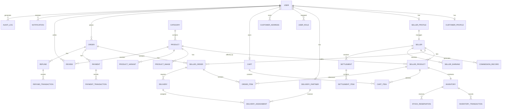

# DATABASE_SCHEMA.md

# MARVEL'S BASKET
## Database Schema & Data Modeling

| Property | Details |
|---|---|
| Project Name | Marvel's Basket |
| Project ID | MB/MT/2026/001 |
| Development Company | Marvel's Techworks |
| Database | PostgreSQL |
| ORM | Prisma |
| Document | DATABASE_SCHEMA.md |
| Version | 1.0 |
| Created Date | 19 November 2026 |
| Status | Initial Schema Draft |

---

# 1. DATABASE OVERVIEW

## 1.1 Objective

This document defines the database architecture and data model for Marvel's Basket.

The database must support:

- Multi-vendor marketplace operations.
- Customer and seller accounts.
- Seller onboarding and verification.
- Product catalog management.
- Seller-specific product listings.
- Inventory and stock reservations.
- Shopping carts.
- Multi-seller checkout.
- Parent and seller orders.
- Payment processing.
- Refund management.
- Commission calculations.
- Seller settlements.
- Delivery partner management.
- Order tracking.
- Coupons and promotions.
- Customer reviews.
- Notifications.
- Administrative operations.
- Audit logs.

## 1.2 Database Technology

| Component | Technology |
|---|---|
| Database | PostgreSQL |
| ORM | Prisma |
| Database Schema | Prisma Schema |
| Migration Management | Prisma Migrate |
| Primary Keys | UUID |
| Monetary Values | Decimal |
| Timestamp Standard | UTC |
| Database Access | NestJS Backend Only |
| Local Database | Docker PostgreSQL |

## 1.3 Database Design Principles

1. Use relational database design.
2. Use UUID primary keys.
3. Enforce referential integrity.
4. Avoid unnecessary data duplication.
5. Maintain independent seller inventory.
6. Preserve historical order and payment information.
7. Use transactions for critical operations.
8. Maintain financial auditability.
9. Use appropriate database indexes.
10. Use soft deletion selectively.
11. Store timestamps in UTC.
12. Never use floating-point types for financial values.
13. Avoid deleting records that participate in financial transactions.
14. Validate all ownership relationships on the backend.

---

# 2. DATABASE ENTITY OVERVIEW

The database is divided into the following domains.

| Domain | Main Entities |
|---|---|
| Identity | User, Role, Permission, UserRole |
| Authentication | Session, VerificationToken |
| Customer | CustomerProfile, CustomerAddress, Wishlist |
| Seller | Seller, SellerProfile, SellerDocument |
| Catalog | Category, Product, ProductImage, ProductVariant |
| Seller Listings | SellerProduct |
| Inventory | Inventory, InventoryTransaction, StockReservation |
| Shopping | Cart, CartItem |
| Orders | Order, SellerOrder, OrderItem |
| Order History | OrderStatusHistory |
| Payments | Payment, PaymentTransaction |
| Refunds | Refund, RefundTransaction |
| Finance | CommissionRule, CommissionRecord, SellerEarning |
| Settlements | Settlement, SettlementItem |
| Delivery | DeliveryPartner, Delivery, DeliveryAssignment |
| Marketing | Coupon, CouponUsage, Banner |
| Engagement | Review, WishlistItem |
| Notifications | Notification, NotificationPreference |
| Administration | AuditLog, AdminActivityLog |
| Configuration | PlatformSetting |

---

# 3. DATABASE RELATIONSHIP ARCHITECTURE

## 3.1 High-Level ER Diagram



---

# 4. ENUM DEFINITIONS

Enums provide consistent values for application states.

The following enums are the initial proposed database enums.

## 4.1 UserRoleType

```prisma
enum UserRoleType {
  CUSTOMER
  SELLER
  DELIVERY_PARTNER
  ADMIN
  SUPER_ADMIN
}
```

## 4.2 UserStatus

```prisma
enum UserStatus {
  ACTIVE
  INACTIVE
  SUSPENDED
  BLOCKED
  DELETED
}
```

## 4.3 SellerStatus

```prisma
enum SellerStatus {
  PENDING
  UNDER_REVIEW
  APPROVED
  REJECTED
  SUSPENDED
  CLOSED
}
```

## 4.4 ProductStatus

```prisma
enum ProductStatus {
  DRAFT
  ACTIVE
  INACTIVE
  ARCHIVED
}
```

## 4.5 SellerProductStatus

```prisma
enum SellerProductStatus {
  PENDING
  ACTIVE
  INACTIVE
  OUT_OF_STOCK
  REJECTED
}
```

## 4.6 OrderStatus

```prisma
enum OrderStatus {
  PENDING_PAYMENT
  CONFIRMED
  PROCESSING
  PARTIALLY_FULFILLED
  FULFILLED
  PARTIALLY_CANCELLED
  CANCELLED
  COMPLETED
  REFUNDED
  PARTIALLY_REFUNDED
  FAILED
}
```

## 4.7 SellerOrderStatus

```prisma
enum SellerOrderStatus {
  PENDING
  ACCEPTED
  REJECTED
  PREPARING
  READY_FOR_PICKUP
  OUT_FOR_DELIVERY
  DELIVERED
  CANCELLED
  COMPLETED
}
```

## 4.8 PaymentStatus

```prisma
enum PaymentStatus {
  PENDING
  PROCESSING
  AUTHORIZED
  CAPTURED
  FAILED
  PARTIALLY_REFUNDED
  REFUNDED
}
```

## 4.9 PaymentMethod

```prisma
enum PaymentMethod {
  RAZORPAY
  COD
}
```

## 4.10 RefundStatus

```prisma
enum RefundStatus {
  PENDING
  PROCESSING
  COMPLETED
  FAILED
  REJECTED
}
```

## 4.11 DeliveryStatus

```prisma
enum DeliveryStatus {
  PENDING
  ASSIGNED
  ACCEPTED
  PICKED_UP
  IN_TRANSIT
  DELIVERED
  FAILED
  CANCELLED
}
```

## 4.12 SettlementStatus

```prisma
enum SettlementStatus {
  PENDING
  PROCESSING
  COMPLETED
  FAILED
  ON_HOLD
}
```

## 4.13 InventoryTransactionType

```prisma
enum InventoryTransactionType {
  STOCK_ADDED
  STOCK_REMOVED
  STOCK_RESERVED
  STOCK_RELEASED
  STOCK_SOLD
  STOCK_ADJUSTED
  STOCK_RETURNED
}
```

## 4.14 StockReservationStatus

```prisma
enum StockReservationStatus {
  ACTIVE
  COMMITTED
  RELEASED
  EXPIRED
}
```

## 4.15 NotificationType

```prisma
enum NotificationType {
  ORDER
  PAYMENT
  DELIVERY
  REFUND
  PROMOTION
  ACCOUNT
  SYSTEM
}
```

## 4.16 NotificationChannel

```prisma
enum NotificationChannel {
  IN_APP
  EMAIL
  SMS
  PUSH
}
```

## 4.17 VerificationTokenType

```prisma
enum VerificationTokenType {
  EMAIL_VERIFICATION
  PASSWORD_RESET
  PHONE_VERIFICATION
}
```

Additional enums may be introduced when new business requirements are approved.

---

# 5. IDENTITY AND AUTHENTICATION MODELS

## 5.1 User

Central identity model for every platform user.

Fields:

| Field | Type | Description |
|---|---|---|
| id | UUID | Primary key |
| name | String | Full name |
| email | String? | Email address |
| phone | String? | Mobile number |
| passwordHash | String? | Hashed password |
| status | UserStatus | Account status |
| emailVerifiedAt | DateTime? | Email verification |
| phoneVerifiedAt | DateTime? | Phone verification |
| lastLoginAt | DateTime? | Last login |
| createdAt | DateTime | Creation timestamp |
| updatedAt | DateTime | Update timestamp |
| deletedAt | DateTime? | Soft deletion |

Constraints:

- Email must be unique when provided.
- Phone must be unique when provided.
- At least one supported login identifier must be available.
- Password hashes must never be returned through APIs.

PostgreSQL partial unique indexes may be required for nullable email and phone fields.

## 5.2 Role

Defines system roles.

Fields:

- id
- name
- description
- createdAt
- updatedAt

## 5.3 Permission

Defines granular permissions.

Fields:

- id
- key
- description
- createdAt

Example permissions:

```text
product.create
product.update
product.delete
order.view
order.update
seller.approve
seller.suspend
payment.view
refund.process
settlement.manage
admin.manage
```

## 5.4 UserRole

Connects users with roles.

Fields:

- id
- userId
- roleId
- assignedAt
- assignedBy

Unique constraint:

`userId + roleId`

## 5.5 RolePermission

Connects roles with permissions.

Fields:

- id
- roleId
- permissionId

Unique constraint:

`roleId + permissionId`

## 5.6 Session

Stores refresh-session information.

Fields:

- id
- userId
- refreshTokenHash
- expiresAt
- revokedAt
- userAgent
- ipAddress
- createdAt
- updatedAt

Refresh tokens must be stored as hashes rather than raw token values.

## 5.7 VerificationToken

Stores verification and password reset tokens.

Fields:

- id
- userId
- tokenHash
- type
- expiresAt
- usedAt
- createdAt

Tokens must be single-use and time-limited.

---

# 6. CUSTOMER MODELS

## 6.1 CustomerProfile

Fields:

- id
- userId
- dateOfBirth (optional)
- avatarUrl (optional)
- createdAt
- updatedAt

Relationship:

One User has one CustomerProfile.

## 6.2 CustomerAddress

Fields:

| Field | Type |
|---|---|
| id | UUID |
| userId | UUID |
| label | String |
| recipientName | String |
| phone | String |
| addressLine1 | String |
| addressLine2 | String? |
| landmark | String? |
| city | String |
| state | String |
| postalCode | String |
| country | String |
| latitude | Decimal? |
| longitude | Decimal? |
| isDefault | Boolean |
| createdAt | DateTime |
| updatedAt | DateTime |

A customer can maintain multiple delivery addresses.

Historical orders must retain address snapshots rather than depending exclusively on the current address record.

---

# 7. SELLER MODELS

## 7.1 Seller

Represents a registered marketplace seller.

Fields:

- id
- ownerUserId
- businessName
- slug
- businessEmail
- businessPhone
- GSTIN (optional)
- PAN (optional)
- status
- approvalDate
- rejectionReason
- suspensionReason
- createdAt
- updatedAt
- deletedAt

Constraints:

- Seller slug must be unique.
- Seller ownership must be validated.
- Seller approval requires administrative authorization.

## 7.2 SellerProfile

Fields:

- id
- sellerId
- logoUrl
- bannerUrl
- description
- addressLine1
- addressLine2
- landmark
- city
- state
- postalCode
- country
- latitude
- longitude
- openingTime
- closingTime
- preparationTime
- createdAt
- updatedAt

## 7.3 SellerDocument

Stores KYC and verification documents.

Fields:

- id
- sellerId
- documentType
- documentUrl
- verificationStatus
- verifiedBy
- verifiedAt
- rejectionReason
- createdAt
- updatedAt

Private document storage is mandatory.

## 7.4 SellerBusinessHours

Fields:

- id
- sellerId
- dayOfWeek
- openingTime
- closingTime
- isClosed

Unique constraint:

`sellerId + dayOfWeek`

## 7.5 SellerServiceArea

Defines seller delivery coverage.

Fields:

- id
- sellerId
- postalCode
- radiusKm (optional)
- latitude (optional)
- longitude (optional)
- isActive
- createdAt

Geospatial coverage can be expanded using PostGIS.

---

# 8. PRODUCT CATALOG MODELS

## 8.1 Category

Supports hierarchical product categories.

Fields:

- id
- parentId
- name
- slug
- description
- imageUrl
- displayOrder
- isActive
- createdAt
- updatedAt

Example:

```text
Groceries
  ├── Fruits
  ├── Vegetables
  ├── Dairy
  └── Staples

Beverages
  ├── Juices
  ├── Soft Drinks
  └── Water

Personal Care
  ├── Skin Care
  └── Hair Care
```

## 8.2 Product

Represents the common marketplace catalog item.

Fields:

- id
- categoryId
- name
- slug
- description
- brand
- SKU
- status
- createdAt
- updatedAt
- deletedAt

A Product does not represent an individual seller's price or stock.

## 8.3 ProductImage

Fields:

- id
- productId
- imageUrl
- altText
- displayOrder
- createdAt

## 8.4 ProductVariant

Represents variations of a catalog product.

Fields:

- id
- productId
- name
- SKU
- attributes (JSON)
- createdAt
- updatedAt

Examples:

- 500 g.
- 1 kg.
- 2 kg.
- Small.
- Medium.
- Large.

Variant-specific seller listings may have independent pricing and stock.

---

# 9. SELLER PRODUCT LISTINGS

## 9.1 SellerProduct

This is one of the most important entities in the marketplace.

A catalog product can be offered by multiple sellers.

Fields:

| Field | Type |
|---|---|
| id | UUID |
| sellerId | UUID |
| productId | UUID |
| variantId | UUID? |
| sellerSKU | String? |
| sellingPrice | Decimal |
| mrp | Decimal? |
| status | SellerProductStatus |
| createdAt | DateTime |
| updatedAt | DateTime |
| deletedAt | DateTime? |

Constraints:

- Seller-specific listing identifiers must be unique where applicable.
- Selling price must be non-negative.
- Seller must be approved before publishing listings.
- Product and variant relationships must be validated.

Recommended unique constraint:

`sellerId + productId + variantId`

For reliable nullable uniqueness, use an appropriate PostgreSQL partial unique index or a non-null canonical listing key.

## 9.2 Why SellerProduct Is Separate

Example:

| Product | Seller | Selling Price | Stock |
|---|---|---:|---:|
| Basmati Rice | Seller A | ₹120 | 20 |
| Basmati Rice | Seller B | ₹115 | 10 |
| Basmati Rice | Seller C | ₹125 | 30 |

One catalog product can have multiple seller-specific offers.

This allows customers to compare sellers and prices.

---

# 10. INVENTORY MODELS

## 10.1 Inventory

Maintains stock for each seller listing.

Fields:

- id
- sellerProductId
- availableQuantity
- reservedQuantity
- lowStockThreshold
- updatedAt

Constraint:

`sellerProductId` must be unique.

Inventory values must never become negative.

Available quantity and reserved quantity must remain consistent with the stock ledger.

## 10.2 InventoryTransaction

Maintains the history of stock changes.

Fields:

- id
- inventoryId
- type
- quantity
- referenceType
- referenceId
- note
- createdBy
- createdAt

Transactions should be append-only from the application's business perspective.

## 10.3 StockReservation

Tracks inventory reserved for checkout.

Fields:

- id
- inventoryId
- orderItemId (optional until order items are created)
- quantity
- status
- expiresAt
- committedAt
- releasedAt
- createdAt

Rules:

- Reservation must be created transactionally.
- Reservation expiration must release stock.
- Successful payment must commit the reservation.
- Failed or expired checkout must release stock.
- Duplicate reservation processing must be prevented.

The checkout implementation must ensure the reservation is durably associated with the checkout/order workflow.

---

# 11. CART MODELS

## 11.1 Cart

Fields:

- id
- userId
- createdAt
- updatedAt

One active cart per customer.

## 11.2 CartItem

Fields:

- id
- cartId
- sellerProductId
- quantity
- createdAt
- updatedAt

Unique constraint:

`cartId + sellerProductId`

Important:

- The cart stores selected listings and quantities.
- The backend recalculates prices.
- The cart does not reserve inventory permanently.
- Unavailable listings must be validated before checkout.

---

# 12. ORDER MODELS

## 12.1 Order

Represents the customer's complete checkout transaction.

Fields:

| Field | Type |
|---|---|
| id | UUID |
| orderNumber | String |
| customerId | UUID |
| addressSnapshot | JSON |
| subtotal | Decimal |
| discountAmount | Decimal |
| deliveryCharge | Decimal |
| taxAmount | Decimal |
| totalAmount | Decimal |
| status | OrderStatus |
| notes | String? |
| placedAt | DateTime? |
| createdAt | DateTime |
| updatedAt | DateTime |

The address snapshot preserves the original delivery address.

Order number must be unique.

## 12.2 SellerOrder

Represents an individual seller's fulfilment responsibility.

Fields:

- id
- orderId
- sellerId
- sellerOrderNumber
- subtotal
- discountAmount
- deliveryCharge
- taxAmount
- totalAmount
- status
- acceptedAt
- rejectedAt
- completedAt
- cancellationReason
- createdAt
- updatedAt

Unique constraints:

- orderId + sellerId
- sellerOrderNumber

A parent order can contain multiple seller orders.

## 12.3 OrderItem

Fields:

- id
- sellerOrderId
- sellerProductId (historical reference)
- productNameSnapshot
- variantNameSnapshot
- SKU
- quantity
- unitPrice
- mrp
- discountAmount
- taxAmount
- totalAmount
- createdAt

Important:

Product name, SKU, price and other order-relevant information must be snapshotted.

Changes to the original product listing must never modify historical order details.

## 12.4 OrderStatusHistory

Fields:

- id
- orderId (optional)
- sellerOrderId (optional)
- previousStatus
- newStatus
- note
- changedBy
- createdAt

This table preserves the order lifecycle.

A history record must reference the relevant parent or seller order.

---

# 13. PAYMENT MODELS

## 13.1 Payment

Represents the payment associated with a parent order.

Fields:

- id
- orderId
- provider
- method
- providerOrderId
- amount
- currency
- status
- paidAt
- createdAt
- updatedAt

An order may have multiple payment attempts.

Payment records must not be overwritten to conceal failed or previous attempts.

## 13.2 PaymentTransaction

Records individual payment events.

Fields:

- id
- paymentId
- providerTransactionId
- eventType
- amount
- status
- providerPayload (JSON)
- processedAt
- createdAt

Constraints:

- Provider transaction references must be unique where available.
- Webhook events must be idempotently processed.
- Sensitive payment information must not be stored.

A separate webhook event identifier or processing record should be maintained for provider event deduplication.

---

# 14. REFUND MODELS

## 14.1 Refund

Represents a refund request.

Fields:

- id
- orderId
- sellerOrderId (optional)
- paymentId
- refundNumber
- amount
- reason
- status
- providerRefundId
- requestedBy
- processedAt
- createdAt
- updatedAt

Refunds must support both complete and partial refunds.

## 14.2 RefundTransaction

Fields:

- id
- refundId
- providerTransactionId
- amount
- status
- providerPayload (JSON)
- processedAt
- createdAt

Refund processing must be idempotent.

A refund request must never automatically be considered successful merely because it was submitted to the payment provider.

---

# 15. COMMISSION AND FINANCIAL MODELS

## 15.1 CommissionRule

Defines marketplace commission policies.

Fields:

- id
- name
- commissionType
- commissionValue
- categoryId (optional)
- sellerId (optional)
- isActive
- effectiveFrom
- effectiveUntil
- createdAt
- updatedAt

Possible commission types:

- FIXED.
- PERCENTAGE.

The commission priority and applicability rules must be defined in business logic.

## 15.2 CommissionRecord

Stores the actual commission calculated for a transaction.

Fields:

- id
- sellerOrderId
- sellerId
- commissionRuleId (optional)
- grossAmount
- commissionAmount
- taxAmount
- netAmount
- createdAt

Commission calculations must be preserved historically.

Changing a commission rule must not modify previously calculated commissions.

## 15.3 SellerEarning

Tracks seller financial credits and adjustments.

Fields:

- id
- sellerId
- sellerOrderId (optional)
- type
- amount
- referenceType
- referenceId
- description
- createdAt

Financial adjustments must have explicit references and reasons.

---

# 16. SETTLEMENT MODELS

## 16.1 Settlement

Represents a seller payout.

Fields:

- id
- settlementNumber
- sellerId
- grossAmount
- commissionAmount
- refundAdjustment
- otherAdjustment
- netAmount
- status
- paymentReference
- initiatedAt
- completedAt
- createdAt
- updatedAt

## 16.2 SettlementItem

Fields:

- id
- settlementId
- sellerEarningId
- amount
- createdAt

A seller earning must not be settled more than once.

Settlements must be auditable and traceable to underlying seller earnings.

---

# 17. DELIVERY MODELS

## 17.1 DeliveryPartner

Fields:

- id
- userId
- vehicleType
- vehicleNumber
- verificationStatus
- availabilityStatus
- rating
- createdAt
- updatedAt

## 17.2 Delivery

Represents delivery for an individual seller order.

Fields:

- id
- sellerOrderId
- status
- pickupAddressSnapshot
- deliveryAddressSnapshot
- estimatedDeliveryAt
- deliveredAt
- deliveryInstructions
- createdAt
- updatedAt

Initially, one seller order should correspond to one delivery record.

## 17.3 DeliveryAssignment

Tracks delivery partner allocation and reassignment.

Fields:

- id
- deliveryId
- deliveryPartnerId
- status
- assignedAt
- acceptedAt
- rejectedAt
- completedAt
- createdAt

Multiple assignment records preserve assignment history.

## 17.4 DeliveryStatusHistory

Fields:

- id
- deliveryId
- previousStatus
- newStatus
- latitude
- longitude
- note
- updatedBy
- createdAt

---

# 18. MARKETING MODELS

## 18.1 Coupon

Fields:

- id
- code
- description
- discountType
- discountValue
- minimumOrderAmount
- maximumDiscount
- usageLimit
- perUserLimit
- startsAt
- expiresAt
- isActive
- createdAt
- updatedAt

## 18.2 CouponUsage

Fields:

- id
- couponId
- userId
- orderId
- discountAmount
- usedAt

Coupon usage must be validated transactionally to prevent exceeding usage limits.

## 18.3 Banner

Fields:

- id
- title
- imageUrl
- targetUrl
- placement
- displayOrder
- startsAt
- expiresAt
- isActive
- createdAt
- updatedAt

---

# 19. ENGAGEMENT MODELS

## 19.1 Review

Fields:

- id
- userId
- productId
- sellerId (optional)
- sellerProductId (optional)
- orderItemId
- rating
- title
- comment
- isVerifiedPurchase
- isPublished
- createdAt
- updatedAt

A review must be associated with a qualifying completed purchase.

The backend must enforce the review eligibility and duplicate-review policy.

## 19.2 Wishlist

Fields:

- id
- userId
- createdAt
- updatedAt

## 19.3 WishlistItem

Fields:

- id
- wishlistId
- productId
- createdAt

Unique constraint:

`wishlistId + productId`

---

# 20. NOTIFICATION MODELS

## 20.1 Notification

Fields:

- id
- userId
- type
- channel
- title
- message
- metadata (JSON)
- isRead
- readAt
- sentAt
- createdAt

## 20.2 NotificationPreference

Fields:

- id
- userId
- channel
- isEnabled
- createdAt
- updatedAt

Unique constraint:

`userId + channel`

---

# 21. ADMINISTRATION MODELS

## 21.1 AuditLog

Records important system actions.

Fields:

- id
- actorUserId
- action
- entityType
- entityId
- oldValues (JSON)
- newValues (JSON)
- ipAddress
- userAgent
- createdAt

Audit records should be append-only for application users.

## 21.2 AdminActivityLog

Fields:

- id
- adminUserId
- action
- module
- description
- metadata (JSON)
- createdAt

## 21.3 PlatformSetting

Fields:

- id
- key
- value (JSON)
- description
- updatedBy
- createdAt
- updatedAt

Unique constraint:

`key`

---

# 22. PRISMA SCHEMA CONVENTIONS

## 22.1 Standard Model Pattern

All models should follow consistent naming and timestamp conventions.

Example:

```prisma
model Example {
  id        String   @id @default(uuid()) @db.Uuid
  name      String
  createdAt DateTime @default(now())
  updatedAt DateTime @updatedAt
}
```

## 22.2 UUID Strategy

Use UUID identifiers for primary keys.

This provides stable identifiers across application modules and external integrations.

Business-facing order numbers should be separate from database identifiers.

## 22.3 Monetary Values

Use Decimal fields.

Example:

```prisma
price Decimal @db.Decimal(12, 2)
```

Never use Float or Double for authoritative monetary values.

Use an explicit currency field where multi-currency support is required.

Initial marketplace currency: INR.

## 22.4 Timestamps

Use:

```prisma
createdAt DateTime @default(now())
updatedAt DateTime @updatedAt
```

Database timestamps should be stored and processed consistently in UTC.

## 22.5 JSON Fields

Use JSON fields only for genuinely flexible information.

Examples:

- Product attributes.
- Provider webhook payloads.
- Address snapshots.
- Audit metadata.
- Notification metadata.

Core relational data must not be hidden inside JSON fields.

---

# 23. INDEXING STRATEGY

The following indexes should be considered during schema implementation.

| Model | Indexed Fields |
|---|---|
| User | email, phone, status |
| Seller | ownerUserId, slug, status |
| Category | parentId, slug |
| Product | categoryId, slug, status |
| SellerProduct | sellerId, productId, status |
| Inventory | sellerProductId |
| Cart | userId |
| CartItem | cartId, sellerProductId |
| Order | orderNumber, customerId, status, createdAt |
| SellerOrder | orderId, sellerId, status |
| Payment | orderId, providerOrderId, status |
| PaymentTransaction | providerTransactionId |
| Refund | orderId, providerRefundId, status |
| Settlement | sellerId, status, createdAt |
| Delivery | sellerOrderId, status |
| Notification | userId, isRead, createdAt |
| AuditLog | actorUserId, entityType, entityId, createdAt |

Indexes must be finalized using actual query patterns and production query analysis.

---

# 24. DATA INTEGRITY AND BUSINESS CONSTRAINTS

## 24.1 Inventory Integrity

- Stock cannot become negative.
- Reservations must not exceed available stock.
- Stock updates must be transactional.
- Every stock adjustment must be traceable.
- Expired reservations must be released.
- Inventory must remain consistent with the stock ledger.

## 24.2 Order Integrity

- Every seller order must belong to a parent order.
- Seller orders must reference valid sellers.
- Order items must preserve price snapshots.
- Parent totals must reconcile with seller-order totals and parent-level adjustments.
- Partial cancellation must not incorrectly cancel unrelated seller orders.

## 24.3 Payment Integrity

- Every payment must reference a valid order.
- Payment verification must happen on the backend.
- Duplicate provider events must not create duplicate financial operations.
- Refunds cannot exceed the refundable amount.
- Failed payment attempts must remain auditable.

## 24.4 Financial Integrity

- Financial calculations must use Decimal arithmetic.
- Seller earnings must be traceable.
- Commission records must be preserved.
- Settlement items must not be duplicated.
- Manual adjustments must be audited.
- Completed financial records must not be silently overwritten.

## 24.5 Data Isolation

- Sellers must access only their own resources.
- Customers must access only their own orders and addresses.
- Delivery partners must access only authorized assignments.
- Administrators must operate according to their permissions.

---

# 25. TRANSACTION STRATEGY

Critical operations must use PostgreSQL transactions.

Examples:

### Checkout

```text
BEGIN TRANSACTION

Validate checkout
Validate listing prices
Reserve inventory
Create parent order
Create seller orders
Create order items
Create payment record
Persist checkout state

COMMIT
```

Payment network calls should not be held open inside long-running database transactions. The implementation should use durable state transitions and idempotent recovery.

### Payment Confirmation

```text
Verify provider event
Check idempotency

BEGIN TRANSACTION

Record payment event
Update payment state
Confirm order
Commit inventory reservations
Create financial records

COMMIT
```

### Refund

```text
Verify refund eligibility
Calculate refundable balance

BEGIN TRANSACTION

Create refund record
Update applicable order state
Create refund adjustment records

COMMIT

Initiate provider refund
Synchronize provider result
```

External payment operations must be coordinated through recoverable workflows rather than assumed to be part of PostgreSQL transactions.

---

# 26. DATABASE MIGRATION STRATEGY

Prisma Migrate will manage schema changes.

Rules:

1. Every schema change must be version-controlled.
2. Migrations must be reviewed.
3. Production migrations must be tested in staging.
4. Never edit already-applied migrations casually.
5. Never use schema push as a substitute for production migrations.
6. Back up production data before risky changes.
7. Use backward-compatible migrations where possible.
8. Separate destructive data migrations from ordinary schema changes.

Commands:

```bash
# Create development migration
pnpm prisma migrate dev --name init

# Apply production migrations
pnpm prisma migrate deploy

# Generate Prisma Client
pnpm prisma generate

# Open Prisma Studio
pnpm prisma studio

# Validate schema
pnpm prisma validate
```

The exact package-specific commands will be defined in the monorepo configuration.

---

# 27. DATABASE BACKUP AND RECOVERY

Production infrastructure must support:

- Automated backups.
- Point-in-time recovery where supported.
- Backup retention policies.
- Recovery testing.
- Restricted backup access.
- Encrypted backups.
- Documented recovery procedures.

Backups must include the database and necessary object-storage references and files.

---

# 28. INITIAL SEED DATA

The initial seed script should create:

- System roles.
- Default permissions.
- Role-permission mappings.
- Initial platform settings.
- Initial product categories.
- Super Admin account through secure environment configuration.

The seed script must be idempotent.

Default administrative credentials must never be hardcoded into source code.

Development test accounts must be separate from production accounts.

---

# 29. FUTURE DATABASE EXTENSIONS

The schema should allow future additions without major restructuring.

Potential extensions:

- PostGIS geographic queries.
- Multiple warehouses.
- Advanced delivery routing.
- Product search indexing.
- Loyalty points.
- Subscription plans.
- Seller advertising.
- Promotional campaigns.
- Push notification tokens.
- Multiple payment providers.
- Automated seller payouts.
- Mobile application sessions.
- Analytics and reporting data warehouse.

These are future capabilities, not mandatory initial-release dependencies.

---

# 30. FINAL DATABASE ARCHITECTURE SUMMARY

The database follows this hierarchy:

```text
IDENTITY
  |
  +-- User
  |    +-- Role
  |    +-- CustomerProfile
  |    +-- SellerProfile
  |    +-- DeliveryPartner
  |
  +-- SELLER
  |    +-- SellerProfile
  |    +-- SellerDocument
  |    +-- SellerServiceArea
  |
  +-- PRODUCT CATALOG
  |    +-- Category
  |    +-- Product
  |    +-- ProductVariant
  |    +-- ProductImage
  |    +-- SellerProduct
  |
  +-- INVENTORY
  |    +-- Inventory
  |    +-- InventoryTransaction
  |    +-- StockReservation
  |
  +-- SHOPPING
  |    +-- Cart
  |    +-- CartItem
  |
  +-- ORDERS
  |    +-- Order
  |    +-- SellerOrder
  |    +-- OrderItem
  |    +-- OrderStatusHistory
  |
  +-- PAYMENTS
  |    +-- Payment
  |    +-- PaymentTransaction
  |    +-- Refund
  |    +-- RefundTransaction
  |
  +-- FINANCE
  |    +-- CommissionRule
  |    +-- CommissionRecord
  |    +-- SellerEarning
  |    +-- Settlement
  |    +-- SettlementItem
  |
  +-- DELIVERY
  |    +-- Delivery
  |    +-- DeliveryAssignment
  |    +-- DeliveryStatusHistory
  |
  +-- PLATFORM
       +-- Notifications
       +-- Reviews
       +-- Coupons
       +-- AuditLogs
       +-- PlatformSettings
```

## PRIMARY DESIGN PRINCIPLES

1. Shared catalog, independent seller listings.
2. Independent inventory per seller.
3. One parent order, multiple seller orders.
4. Transaction-safe checkout.
5. Reliable payment and refund processing.
6. Traceable seller earnings and settlements.
7. Strict user and seller data isolation.
8. Historical financial data preservation.
9. Scalable relational database architecture.
10. Prisma-managed schema migrations.

---

# 31. RELATED DOCUMENTATION

1. PROJECT_CONTEXT.md
2. PROJECT_REQUIREMENTS.md
3. TECHNICAL_ARCHITECTURE.md
4. DATABASE_SCHEMA.md
5. PROJECT_STATUS.md
6. PROJECT_DECISIONS.md
7. IMPLEMENTATION_PHASES.md

All implementation-level database models must follow this approved schema baseline or have their changes documented in PROJECT_DECISIONS.md.

---

# END OF DATABASE_SCHEMA.md

**Project:** Marvel's Basket  
**Project ID:** MB/MT/2026/001  
**Prepared By:** Marvel's Techworks  
**Document:** DATABASE_SCHEMA.md  
**Version:** 1.0  
**Status:** Initial Schema Draft