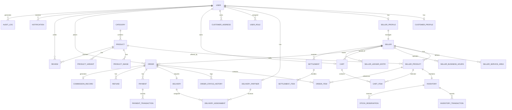

# DATABASE_SCHEMA.md

# MARVEL'S BASKET
## Database Schema & Data Modeling

| Property | Details |
|---|---|
| Project Name | Marvel's Basket |
| Project ID | MB/MT/2026/001 |
| Development Company | Marvel's Techworks |
| Database | PostgreSQL |
| ORM | Prisma |
| Document | DATABASE_SCHEMA.md |
| Version | 1.0 |
| Created Date | 19 November 2026 |
| Status | Initial Schema Draft |

---

# 1. DATABASE OVERVIEW

## 1.1 Objective

This document defines the database architecture and data model for Marvel's Basket.

The database must support:

- Hybrid / Aggregator marketplace model with platform master catalog and store-specific listings.
- Customer and seller accounts with role-based access control.
- Admin-verified seller onboarding and KYC document tracking.
- Product catalog and category hierarchy.
- Store-specific product listings, inventory, and stock reservations.
- Single-store shopping carts with store-switch confirmation support.
- Single-store customer orders (eliminating multi-seller split order complexity for MVP).
- Payment processing via Razorpay (UPI, Cards, Netbanking) and Cash on Delivery (COD).
- Payment webhook idempotency and signature audit records.
- Customer complaint, cancellation, and source refund workflows.
- Category-based platform commission calculation.
- Double-entry auditable seller financial ledger.
- Seller batch settlements and payout holds.
- Platform-managed delivery dispatch, rider assignment, and milestone tracking.
- Coupons, promotions, and platform settings.
- Comprehensive administrative and financial audit logs.

## 1.2 Database Technology

| Component | Technology |
|---|---|
| Database | PostgreSQL 16 |
| ORM | Prisma ORM |
| Database Schema | Prisma Schema (`packages/database/prisma/schema.prisma`) |
| Migration Management | Prisma Migrate |
| Primary Keys | UUID v4 (`@default(uuid()) @db.Uuid`) |
| Monetary Values | Decimal (`@db.Decimal(12, 2)`) |
| Timestamp Standard | UTC (`DateTime @default(now())`) |
| Database Access | NestJS Backend (`apps/api`) Only |
| Local Database | Dockerized PostgreSQL 16 |

## 1.3 Database Design Principles

1. Relational Integrity: Enforce strict foreign key constraints across all models.
2. Store Isolation: Guarantee store-level data isolation for listings, stock, and orders.
3. Single-Store Order Boundary: Every order maps to exactly one store, eliminating parent/sub-order coordination bugs in the MVP.
4. Monetary Precision: All currency values use `Decimal(12, 2)`—never use floating-point types.
5. Immutability of Records: Order item snapshots, address snapshots, and ledger entries are append-only and immutable.
6. Webhook Idempotency: All payment and refund webhook events are deduplicated via unique event IDs.
7. Concurrency Control: Inventory reservation uses atomic conditional updates or row-level locking with strict 15-minute TTL.
8. Audit Trail: Every administrative and financial mutation produces a traceable `AuditLog` or `SellerLedgerEntry`.

---

# 2. DATABASE ENTITY OVERVIEW

The database is divided into the following operational domains:

| Domain | Main Entities |
|---|---|
| Identity & Auth | `User`, `Role`, `Permission`, `UserRole`, `Session`, `VerificationToken` |
| Customer | `CustomerProfile`, `CustomerAddress`, `Wishlist`, `WishlistItem` |
| Seller / Store | `Seller`, `SellerProfile`, `SellerKYC`, `SellerDocument`, `SellerBusinessHours`, `SellerServiceArea` |
| Catalog | `Category`, `Brand`, `Product`, `ProductVariant`, `ProductImage`, `ProductAttributeDefinition` |
| Store Listings | `SellerProduct` (Store Product Listing) |
| Inventory | `Inventory`, `InventoryTransaction`, `StockReservation` |
| Shopping Cart | `Cart`, `CartItem` (Bound to single store) |
| Orders | `Order`, `OrderItem`, `OrderStatusHistory` |
| Payments | `Payment`, `PaymentTransaction`, `PaymentWebhookEvent` |
| Refunds | `Refund`, `RefundTransaction` |
| Finance & Ledger | `CommissionRule`, `CommissionRecord`, `SellerLedgerEntry` |
| Settlements | `Settlement`, `SettlementItem` |
| Delivery | `DeliveryPartner`, `Delivery`, `DeliveryAssignment`, `DeliveryStatusHistory` |
| Marketing | `Coupon`, `CouponUsage`, `Banner` |
| Engagement | `Review` |
| Notifications | `Notification`, `NotificationPreference` |
| Administration | `AuditLog`, `AdminActivityLog`, `PlatformSetting` |

---

# 3. DATABASE RELATIONSHIP ARCHITECTURE

## 3.1 High-Level ER Diagram



---

# 4. ENUM DEFINITIONS

## 4.1 UserRoleType
```prisma
enum UserRoleType {
  CUSTOMER
  SELLER
  DELIVERY_PARTNER
  ADMIN
  SUPER_ADMIN
}
```

## 4.2 UserStatus
```prisma
enum UserStatus {
  ACTIVE
  INACTIVE
  SUSPENDED
  BLOCKED
  DELETED
}
```

## 4.3 SellerStatus
```prisma
enum SellerStatus {
  DRAFT
  PENDING
  UNDER_REVIEW
  APPROVED
  REJECTED
  SUSPENDED
  CLOSED
}
```

## 4.4 ProductStatus
```prisma
enum ProductStatus {
  DRAFT
  ACTIVE
  INACTIVE
  ARCHIVED
}
```

## 4.5 SellerProductStatus
```prisma
enum SellerProductStatus {
  PENDING
  ACTIVE
  INACTIVE
  OUT_OF_STOCK
  REJECTED
}
```

## 4.6 OrderStatus
```prisma
enum OrderStatus {
  PENDING
  CONFIRMED
  PACKED
  OUT_FOR_DELIVERY
  DELIVERED
  CANCELLED
  REJECTED
  FAILED
  RETURN_REQUESTED
  REFUNDED
}
```

## 4.7 PaymentStatus
```prisma
enum PaymentStatus {
  PENDING
  PROCESSING
  SUCCESS
  FAILED
  CANCELLED
  REFUND_PENDING
  PARTIALLY_REFUNDED
  REFUNDED
}
```

## 4.8 PaymentMethod
```prisma
enum PaymentMethod {
  RAZORPAY
  COD
}
```

## 4.9 RefundStatus
```prisma
enum RefundStatus {
  PENDING
  PROCESSING
  COMPLETED
  FAILED
  REJECTED
}
```

## 4.10 DeliveryStatus
```prisma
enum DeliveryStatus {
  PENDING
  ASSIGNED
  ACCEPTED
  PICKED_UP
  IN_TRANSIT
  DELIVERED
  FAILED
  CANCELLED
}
```

## 4.11 DeliveryAssignmentStatus
```prisma
enum DeliveryAssignmentStatus {
  OFFERED
  ACCEPTED
  REJECTED
  EXPIRED
  CANCELLED
}
```

## 4.12 SettlementStatus
```prisma
enum SettlementStatus {
  PENDING
  PROCESSING
  COMPLETED
  FAILED
  ON_HOLD
}
```

## 4.13 LedgerEntryType
```prisma
enum LedgerEntryType {
  ORDER_CREDIT
  COMMISSION_DEBIT
  REFUND_DEBIT
  SETTLEMENT_PAYOUT
  ADJUSTMENT
}
```

## 4.14 StockReservationStatus
```prisma
enum StockReservationStatus {
  ACTIVE
  COMMITTED
  RELEASED
  EXPIRED
}
```

## 4.15 NotificationType

```prisma
enum NotificationType {
  ORDER
  PAYMENT
  DELIVERY
  REFUND
  PROMOTION
  ACCOUNT
  SYSTEM
}
```

## 4.16 NotificationChannel

```prisma
enum NotificationChannel {
  IN_APP
  EMAIL
  SMS
  PUSH
}
```

## 4.17 VerificationTokenType

```prisma
enum VerificationTokenType {
  EMAIL_VERIFICATION
  PASSWORD_RESET
  PHONE_VERIFICATION
}
```

Additional enums may be introduced when new business requirements are approved.

---

# 5. IDENTITY AND AUTHENTICATION MODELS

## 5.1 User

Central identity model for every platform user.

Fields:

| Field | Type | Description |
|---|---|---|
| id | UUID | Primary key |
| name | String | Full name |
| email | String? | Email address |
| phone | String? | Mobile number |
| passwordHash | String? | Hashed password |
| status | UserStatus | Account status |
| emailVerifiedAt | DateTime? | Email verification |
| phoneVerifiedAt | DateTime? | Phone verification |
| lastLoginAt | DateTime? | Last login |
| createdAt | DateTime | Creation timestamp |
| updatedAt | DateTime | Update timestamp |
| deletedAt | DateTime? | Soft deletion |

Constraints:

- Email must be unique when provided.
- Phone must be unique when provided.
- At least one supported login identifier must be available.
- Password hashes must never be returned through APIs.

PostgreSQL partial unique indexes may be required for nullable email and phone fields.

## 5.2 Role

Defines system roles.

Fields:

- id
- name
- description
- createdAt
- updatedAt

## 5.3 Permission

Defines granular permissions.

Fields:

- id
- key
- description
- createdAt

Example permissions:

```text
product.create
product.update
product.delete
order.view
order.update
seller.approve
seller.suspend
payment.view
refund.process
settlement.manage
admin.manage
```

## 5.4 UserRole

Connects users with roles.

Fields:

- id
- userId
- roleId
- assignedAt
- assignedBy

Unique constraint:

`userId + roleId`

## 5.5 RolePermission

Connects roles with permissions.

Fields:

- id
- roleId
- permissionId

Unique constraint:

`roleId + permissionId`

## 5.6 Session

Stores refresh-session information with RFC 6749 token family rotation and reuse detection.

Fields:

- id (UUID v4, PK)
- userId (UUID v4, FK -> users.id, Cascade Delete)
- refreshTokenHash (String, SHA-256 hash of opaque refresh token)
- tokenFamilyId (UUID v4, nullable, indexed, tracks lineage of rotated tokens)
- expiresAt (DateTime, indexed)
- revokedAt (DateTime, nullable)
- userAgent (String, nullable)
- ipAddress (String, nullable)
- createdAt (DateTime)
- updatedAt (DateTime)

Refresh tokens must always be stored as SHA-256 hashes rather than raw token values. The `tokenFamilyId` groups all tokens descended from an initial login session; if an already-revoked token is submitted for refresh, all active sessions belonging to the same `tokenFamilyId` are immediately invalidated (Migration `20261119081743_session_token_family`).

## 5.7 VerificationToken

Stores verification and password reset tokens.

Fields:

- id
- userId
- tokenHash
- type
- expiresAt
- usedAt
- createdAt

Tokens must be single-use and time-limited.

---

# 6. CUSTOMER MODELS

## 6.1 CustomerProfile

Fields:

- id
- userId
- dateOfBirth (optional)
- avatarUrl (optional)
- createdAt
- updatedAt

Relationship:

One User has one CustomerProfile.

## 6.2 CustomerAddress

Fields:

| Field | Type |
|---|---|
| id | UUID |
| userId | UUID |
| label | String |
| recipientName | String |
| phone | String |
| addressLine1 | String |
| addressLine2 | String? |
| landmark | String? |
| city | String |
| state | String |
| postalCode | String |
| country | String |
| latitude | Decimal? |
| longitude | Decimal? |
| isDefault | Boolean |
| createdAt | DateTime |
| updatedAt | DateTime |

A customer can maintain multiple delivery addresses.

Historical orders must retain address snapshots rather than depending exclusively on the current address record.

### Business & Data Invariants (Phase 06)
1. **At Most One Default Address:** At any point in time, a customer must have at most one address where `isDefault = true`.
2. **First Address Policy:** The first address created by a customer is automatically designated as `isDefault = true`.
3. **Atomic Replacement:** Designating an address as default atomically sets all other addresses for that customer to `isDefault = false` inside a PostgreSQL transaction.
4. **Promotion Upon Deletion:** When a default address is deleted, the transaction automatically designates the most recently updated remaining address as `isDefault = true`.
5. **Indexes:** `customer_addresses` is indexed on `userId` (for fast customer lookups) and `postalCode` (for hyperlocal serviceability checks).

---

# 7. SELLER MODELS

## 7.1 Seller

Represents a registered marketplace seller and holds onboarding draft progress, legal/tax registration details, bank accounts, and verification states.

Fields:

- `id` (UUID, PK)
- `userId` (UUID, FK -> users.id, Unique)
- `businessName` (String)
- `storeDisplayName` (String, Optional)
- `storeCategory` (String, Optional)
- `legalBusinessName` (String, Optional)
- `businessEntityType` (String, Optional: SOLE_PROPRIETORSHIP, PARTNERSHIP, LLP, PRIVATE_LIMITED, OTHER)
- `slug` (String, Unique)
- `businessEmail` (String)
- `businessPhone` (String)
- `pan` (String, Optional)
- `gstin` (String, Optional)
- `fssaiNumber` (String, Optional, Mandatory for food/grocery sellers)
- `fssaiExpiryDate` (Date, Optional)
- `shopEstablishmentNumber` (String, Optional)
- `bankAccountHolderName` (String, Optional)
- `bankAccountNumberEncrypted` (String, Optional, AES-256-GCM encrypted ciphertext)
- `bankAccountNumberMasked` (String, Optional, e.g. `••••••••1234`)
- `bankIfscCode` (String, Optional)
- `bankName` (String, Optional)
- `bankAccountType` (String, Optional: CURRENT, SAVINGS)
- `upiId` (String, Optional)
- `currentStep` (Int, Default: 1, Tracks 1–5 onboarding wizard progress)
- `isSubmitted` (Boolean, Default: false)
- `submittedAt` (DateTime, Optional)
- `status` (Enum `SellerStatus`: `DRAFT`, `PENDING_VERIFICATION`, `UNDER_REVIEW`, `APPROVED_ACTIVE`, `REJECTED`, `SUSPENDED`)
- `approvalDate` (DateTime, Optional)
- `rejectionReason` (String, Optional)
- `suspensionReason` (String, Optional)
- `reviewedBy` (UUID, Optional, FK -> users.id)
- `reviewedAt` (DateTime, Optional)
- `createdAt` (DateTime)
- `updatedAt` (DateTime)
- `deletedAt` (DateTime, Optional)

Constraints & Security:

- `userId` is unique (1:1 relationship with User account).
- `slug` is unique across the platform.
- `bankAccountNumberEncrypted` stores AES-256-GCM encrypted data; plaintext is never persisted or logged.
- `status` enforces the 5-state lifecycle state machine.
- Approval atomically sets `status = APPROVED_ACTIVE`, activates associated store (`Store.isActive = true`), and assigns `SELLER` role to the user.

## 7.2 SellerProfile

Stores extended operational settings, service parameters, and branding imagery.

Fields:

- `id` (UUID, PK)
- `sellerId` (UUID, FK -> sellers.id, Unique)
- `logoUrl` (String, Optional)
- `bannerUrl` (String, Optional)
- `storefrontPhotoUrl` (String, Optional)
- `storefrontPhotoPublicId` (String, Optional)
- `storeInteriorPhotoUrl` (String, Optional)
- `storeInteriorPhotoPublicId` (String, Optional)
- `description` (String, Optional)
- `serviceRadiusKm` (Decimal(5, 2), Default: 5.00)
- `weeklyOffDays` (String, Default: "None")
- `addressLine1` (String)
- `addressLine2` (String, Optional)
- `landmark` (String, Optional)
- `city` (String)
- `state` (String)
- `postalCode` (String)
- `country` (String, Default: "IN")
- `latitude` (Decimal(10, 8), Optional)
- `longitude` (Decimal(11, 8), Optional)
- `openingTime` (String, Default: "07:00")
- `closingTime` (String, Default: "22:00")
- `preparationTime` (Int, Default: 15 minutes)
- `createdAt` (DateTime)
- `updatedAt` (DateTime)

## 7.3 SellerDocument

Stores KYC and compliance verification documents securely managed via authenticated Cloudinary private delivery.

Fields:

- `id` (UUID, PK)
- `sellerId` (UUID, FK -> sellers.id)
- `documentType` (Enum `SellerDocumentType`: `PAN_CARD`, `GST_CERTIFICATE`, `FSSAI_CERTIFICATE`, `BANK_PROOF`, `ADDRESS_PROOF`, `SHOP_ESTABLISHMENT`)
- `documentUrl` (String, Authenticated delivery URL)
- `cloudinaryPublicId` (String, Optional, e.g. `sellers/kyc/<sellerId>/...`)
- `originalFilename` (String, Optional)
- `mimeType` (String, Optional: image/jpeg, image/png, image/webp, application/pdf)
- `fileSize` (Int, Optional, Max: 10MB)
- `expiryDate` (Date, Optional)
- `verificationStatus` (Enum `VerificationStatus`: `PENDING`, `PENDING_REVIEW`, `VERIFIED`, `REJECTED`, `NEEDS_RESUBMISSION`)
- `verifiedBy` (UUID, Optional, FK -> users.id)
- `verifiedAt` (DateTime, Optional)
- `rejectionReason` (String, Optional)
- `createdAt` (DateTime)
- `updatedAt` (DateTime)

Constraints:

- KYC documents are uploaded as authenticated private assets; public reading without a signed URL or admin session is strictly forbidden.
- Max file size: 10MB; allowed MIME types: `application/pdf`, `image/jpeg`, `image/png`, `image/webp`.

## 7.4 SellerDocumentReview

Maintains an append-only audit trail of individual KYC document inspection, status transitions, and administrative feedback notes.

Fields:

- `id` (UUID, PK)
- `documentId` (UUID, FK -> seller_documents.id)
- `reviewedBy` (UUID, FK -> users.id)
- `previousStatus` (Enum `VerificationStatus`)
- `newStatus` (Enum `VerificationStatus`)
- `notes` (String, Optional)
- `createdAt` (DateTime)

## 7.5 SellerStatusHistory

Maintains an immutable historical audit log of overall seller onboarding and operational lifecycle transitions (`DRAFT`, `PENDING_VERIFICATION`, `APPROVED_ACTIVE`, `REJECTED`, `SUSPENDED`).

Fields:

- `id` (UUID, PK)
- `sellerId` (UUID, FK -> sellers.id)
- `previousStatus` (Enum `SellerStatus`)
- `newStatus` (Enum `SellerStatus`)
- `reason` (String, Optional)
- `changedBy` (UUID, Optional, FK -> users.id)
- `createdAt` (DateTime)

## 7.6 SellerBusinessHours

Fields:

- `id` (UUID, PK)
- `sellerId` (UUID, FK -> sellers.id)
- `dayOfWeek` (Int, 0=Sunday..6=Saturday)
- `openingTime` (String)
- `closingTime` (String)
- `isClosed` (Boolean, Default: false)

Unique constraint: `sellerId + dayOfWeek`

## 7.7 SellerServiceArea

Defines seller delivery coverage.

Fields:

- `id` (UUID, PK)
- `sellerId` (UUID, FK -> sellers.id)
- `postalCode` (String)
- `radiusKm` (Decimal(5, 2), Optional)
- `latitude` (Decimal(10, 8), Optional)
- `longitude` (Decimal(11, 8), Optional)
- `isActive` (Boolean, Default: true)
- `createdAt` (DateTime)
- isActive
- createdAt

Geospatial coverage can be expanded using PostGIS.

---

# 8. PRODUCT CATALOG MODELS

## 8.1 Category

Supports a 2-tier hierarchical product category taxonomy (L1 Department / L2 Subcategory). Platform-owned.

| Field | Type | Description |
|---|---|---|
| id | UUID | Primary key (`@default(uuid())`) |
| parentId | UUID? | Self-referential foreign key to parent Category (L1 if null, L2 if set) |
| name | String | Category title (e.g. 'Dairy, Bread & Eggs') |
| slug | String | Unique URL slug (`@unique`) |
| description | String? | Optional long description |
| iconUrl | String? | Cloudinary icon URL |
| iconPublicId | String? | Cloudinary public ID for icon asset lifecycle |
| imageUrl | String? | Cloudinary promotional/banner image URL |
| imagePublicId | String? | Cloudinary public ID for banner asset lifecycle |
| displayOrder | Int | Numeric sorting order (`@default(0)`) |
| isActive | Boolean | Visibility toggle (`@default(true)`) |
| taxCode | String? | HSN / SAC classification code |
| defaultGstRate | Decimal? | Default GST tax percentage (`@db.Decimal(5, 2)`) |
| createdAt | DateTime | Record creation timestamp |
| updatedAt | DateTime | Automatic update timestamp |

Relationships:
- `parent`: `Category?` via `parentId`
- `children`: `Category[]`
- `products`: `Product[]`
- `commissionRules`: `CommissionRule[]`

Indexes:
- `@@index([parentId])`
- `@@index([slug])`
- `@@index([displayOrder])`

## 8.2 Brand

Platform-owned verified manufacturer and brand catalog.

| Field | Type | Description |
|---|---|---|
| id | UUID | Primary key (`@default(uuid())`) |
| name | String | Brand name (e.g. 'Amul', 'Nestlé') (`@unique`) |
| slug | String | Unique URL slug (`@unique`) |
| logoUrl | String? | Cloudinary brand logo URL |
| logoPublicId | String? | Cloudinary public ID for brand logo |
| description | String? | Optional brand overview |
| isActive | Boolean | Brand active flag (`@default(true)`) |
| createdAt | DateTime | Creation timestamp |
| updatedAt | DateTime | Update timestamp |

Relationships:
- `products`: `Product[]`

Indexes:
- `@@index([slug])`

## 8.3 Product (Master Product)

Represents the centralized platform-owned catalog product definition. Master products define what the item is (content, imagery, attributes, dietary flags), while individual stores attach pricing and stock through `SellerProduct` and `Inventory`.

| Field | Type | Description |
|---|---|---|
| id | UUID | Primary key (`@default(uuid())`) |
| categoryId | UUID | Foreign key to Category (`onDelete: Restrict`) |
| brandId | UUID? | Optional foreign key to Brand (`onDelete: SetNull`) |
| name | String | Product title |
| slug | String | Unique URL slug (`@unique`) |
| shortDescription | String? | Punchy summary / teaser text |
| description | String? | Detailed product description / overview |
| brand | String? | Free-text brand fallback name |
| sku | String? | Master catalog SKU (`@unique`) |
| foodPreference | FoodPreference | Dietary classification: `VEG`, `NON_VEG`, `EGG`, `VEGAN`, `NA` (`@default(NA)`) |
| countryOfOrigin | String? | Mandatory compliance field (`@default("India")`) |
| manufacturerDetails | String? | FSSAI / Legal metrology manufacturer address |
| packerDetails | String? | FSSAI / Legal metrology packer details |
| shelfLife | String? | Shelf life duration (e.g. '90 days from mfg') |
| storageInstructions | String? | Storage recommendations (e.g. 'Store in cool dry place') |
| ingredients | String? | Ingredients listing |
| nutritionalInfo | Json? | Structured nutritional data (energy, protein, fat, carbs) |
| specifications | Json? | Technical / physical specifications |
| attributes | Json? | Dynamic category-specific key-value attributes |
| searchTags | String[] | Synonyms & search terms (e.g. ['doodh', 'fresh milk']) |
| isFeatured | Boolean | Homepage / curated rail promotion flag (`@default(false)`) |
| status | ProductStatus | Publication state: `DRAFT`, `ACTIVE`, `INACTIVE`, `DISCONTINUED`, `ARCHIVED` |
| createdAt | DateTime | Creation timestamp |
| updatedAt | DateTime | Update timestamp |
| deletedAt | DateTime? | Soft deletion timestamp |

Relationships:
- `category`: `Category`
- `brandRel`: `Brand?`
- `images`: `ProductImage[]`
- `variants`: `ProductVariant[]`
- `sellerProducts`: `SellerProduct[]`
- `wishlistItems`: `WishlistItem[]`
- `reviews`: `Review[]`

Indexes:
- `@@index([categoryId])`
- `@@index([brandId])`
- `@@index([status])`
- `@@index([foodPreference])`
- `@@index([isFeatured])`
- `@@index([name])`

## 8.4 ProductVariant

Represents specific packaging sizes, weights, or physical variations of a master product.

| Field | Type | Description |
|---|---|---|
| id | UUID | Primary key (`@default(uuid())`) |
| productId | UUID | Foreign key to Product (`onDelete: Cascade`) |
| name | String | Variant display name (e.g. '500 ml Pouch') |
| packSize | String? | Standard pack size label (e.g. '500 ml', '1 kg') |
| unitValue | Decimal? | Numeric unit measurement (`@db.Decimal(10, 2)`) |
| unitType | String? | Unit code (`ml`, `g`, `kg`, `l`, `pcs`) |
| mrp | Decimal | Maximum Retail Price ceiling in INR (`@db.Decimal(12, 2)`) |
| sku | String? | Unique variant barcode/SKU (`@unique`) |
| barcode | String? | EAN-13 / UPC barcode number |
| primaryImageUrl | String? | Direct image shortcut URL |
| primaryImagePublicId | String? | Direct image Cloudinary public ID |
| isActive | Boolean | Availability toggle (`@default(true)`) |
| displayOrder | Int | Sorting order within product (`@default(0)`) |
| attributes | Json? | Variant-level custom attributes |
| createdAt | DateTime | Creation timestamp |
| updatedAt | DateTime | Update timestamp |

Relationships:
- `product`: `Product`
- `images`: `ProductImage[]`
- `sellerProducts`: `SellerProduct[]`

Indexes:
- `@@index([productId])`
- `@@index([barcode])`

## 8.5 ProductImage

Cloudinary-managed high-resolution product photography. A master product enforces a strict maximum of 5 images per variant.

| Field | Type | Description |
|---|---|---|
| id | UUID | Primary key (`@default(uuid())`) |
| productId | UUID | Foreign key to Product (`onDelete: Cascade`) |
| variantId | UUID? | Optional foreign key to ProductVariant (`onDelete: Cascade`) |
| imageUrl | String | Cloudinary secure delivery URL |
| publicId | String? | Cloudinary asset public ID for cleanup on deletion |
| altText | String? | Accessible screen-reader alt text |
| isPrimary | Boolean | Primary card thumbnail flag (`@default(false)`) |
| displayOrder | Int | Gallery sequence order (`@default(0)`) |
| createdAt | DateTime | Creation timestamp |

Relationships:
- `product`: `Product`
- `variant`: `ProductVariant?`

Indexes:
- `@@index([productId])`
- `@@index([variantId])`

## 8.6 ProductAttributeDefinition

Schema definitions for category-scoped custom product attributes (e.g. fat content for milk, organic certification for grains).

| Field | Type | Description |
|---|---|---|
| id | UUID | Primary key (`@default(uuid())`) |
| categoryId | UUID? | Scoped Category (`null` = global attribute) |
| name | String | Human-readable label (e.g. 'Milk Fat Content') |
| key | String | Attribute JSON key identifier (e.g. 'fat_percentage') |
| attributeType | String | Data type: `text`, `number`, `select`, `boolean` |
| isRequired | Boolean | Mandatory attribute enforcement flag |
| options | Json? | Selectable dropdown options array |
| createdAt | DateTime | Creation timestamp |
| updatedAt | DateTime | Update timestamp |

Constraints:
- `@@unique([categoryId, key])`

---

# 9. SELLER PRODUCT LISTINGS

## 9.1 SellerProduct

This is one of the most important entities in the marketplace.

A catalog product can be offered by multiple sellers.

Fields:

| Field | Type |
|---|---|
| id | UUID |
| sellerId | UUID |
| productId | UUID |
| variantId | UUID? |
| sellerSKU | String? |
| sellingPrice | Decimal |
| mrp | Decimal? |
| status | SellerProductStatus |
| createdAt | DateTime |
| updatedAt | DateTime |
| deletedAt | DateTime? |

Constraints:

- Seller-specific listing identifiers must be unique where applicable.
- Selling price must be non-negative.
- Seller must be approved before publishing listings.
- Product and variant relationships must be validated.

Recommended unique constraint:

`sellerId + productId + variantId`

For reliable nullable uniqueness, the following PostgreSQL partial unique index is implemented and applied via migration (`20261119075000_seller_product_null_variant_unique`):

```sql
CREATE UNIQUE INDEX "seller_products_seller_id_product_id_null_variant_key"
ON "seller_products"("seller_id", "product_id")
WHERE "variant_id" IS NULL;
```

This guarantees that a seller cannot list the same master product twice when `variant_id` is null.

## 9.2 Why SellerProduct Is Separate

Example:

| Product | Seller | Selling Price | Stock |
|---|---|---:|---:|
| Basmati Rice | Seller A | ₹120 | 20 |
| Basmati Rice | Seller B | ₹115 | 10 |
| Basmati Rice | Seller C | ₹125 | 30 |

One catalog product can have multiple seller-specific offers.

This allows customers to compare sellers and prices.

---

# 10. INVENTORY MODELS

## 10.1 Inventory

Maintains stock for each seller listing.

Fields:

- id
- sellerProductId
- availableQuantity
- reservedQuantity
- lowStockThreshold
- updatedAt

Constraint:

`sellerProductId` must be unique.

Inventory values must never become negative.

Available quantity and reserved quantity must remain consistent with the stock ledger.

## 10.2 InventoryTransaction

Maintains the history of stock changes.

Fields:

- id
- inventoryId
- type
- quantity
- referenceType
- referenceId
- note
- createdBy
- createdAt

Transactions should be append-only from the application's business perspective.

## 10.3 StockReservation

Tracks inventory reserved for checkout.

Fields:

- id
- inventoryId
- orderItemId (optional until order items are created)
- quantity
- status
- expiresAt
- committedAt
- releasedAt
- createdAt

Rules:

- Reservation must be created transactionally.
- Reservation expiration must release stock.
- Successful payment must commit the reservation.
- Failed or expired checkout must release stock.
- Duplicate reservation processing must be prevented.

The checkout implementation must ensure the reservation is durably associated with the checkout/order workflow.

---

# 11. CART MODELS

# 11. CART MODELS

## 11.1 Cart

Represents an active shopping cart for an authenticated customer, strictly bound to a single store for the MVP.

Fields:

| Field | Type | Description |
|---|---|---|
| id | UUID | Primary key |
| userId | UUID | Unique customer owner reference |
| sellerId | UUID? | Active store constraint (locks cart to this store) |
| createdAt | DateTime | Cart creation timestamp |
| updatedAt | DateTime | Last update timestamp |

Constraints & Rules:
- Unique constraint: `userId` (one active cart per customer).
- When the first item is added, `sellerId` is set to that item's store.
- Attempting to add an item from a different `sellerId` triggers a client confirmation prompt to clear the existing cart.
- When all items are removed, `sellerId` becomes null.

## 11.2 CartItem

Fields:

| Field | Type | Description |
|---|---|---|
| id | UUID | Primary key |
| cartId | UUID | Foreign key to `Cart` |
| sellerProductId | UUID | Foreign key to `SellerProduct` |
| quantity | Int | Selected quantity (must be >= 1) |
| createdAt | DateTime | Creation timestamp |
| updatedAt | DateTime | Update timestamp |

Constraints:
- Unique constraint: `cartId + sellerProductId`.
- Prices are never stored in `CartItem`; the backend recalculates prices dynamically against `SellerProduct.sellingPrice`.

---

# 12. ORDER MODELS

## 12.1 Order (Single-Store Order)

Represents the complete customer purchase, directly fulfilled by exactly one store.

Fields:

| Field | Type | Description |
|---|---|---|
| id | UUID | Primary key |
| orderNumber | String | Unique human-readable identifier (e.g. `MB-2026-00001`) |
| customerId | UUID | Foreign key to `User` (Customer) |
| sellerId | UUID | Foreign key to `Seller` (Fulfilling Store) |
| addressSnapshot | JSON | Frozen delivery address, landmark, PIN, phone, and GPS coordinates |
| subtotal | Decimal(12, 2) | Gross item total at store selling prices |
| deliveryFee | Decimal(12, 2) | Platform delivery charge |
| discountAmount | Decimal(12, 2) | Platform coupon discount |
| taxAmount | Decimal(12, 2) | Applicable regulatory taxes |
| totalAmount | Decimal(12, 2) | Final payable total (`subtotal + deliveryFee - discountAmount`) |
| status | OrderStatus | Operational status (`PENDING`, `CONFIRMED`, `PACKED`, `OUT_FOR_DELIVERY`, `DELIVERED`, `CANCELLED`, `REJECTED`, `FAILED`, `RETURN_REQUESTED`, `REFUNDED`) |
| paymentStatus | PaymentStatus | Financial status (`PENDING`, `PROCESSING`, `SUCCESS`, `FAILED`, `REFUNDED`, `PARTIALLY_REFUNDED`) |
| deliveryStatus | DeliveryStatus | Transit status (`PENDING`, `ASSIGNED`, `ACCEPTED`, `PICKED_UP`, `IN_TRANSIT`, `DELIVERED`, `FAILED`) |
| notes | String? | Customer delivery instructions |
| cancellationReason | String? | Reason if cancelled or rejected |
| cancelledAt | DateTime? | Cancellation timestamp |
| packedAt | DateTime? | Timestamp when store finished packing |
| deliveredAt | DateTime? | Timestamp when customer received delivery |
| createdAt | DateTime | Order placement timestamp |
| updatedAt | DateTime | Last modification timestamp |

Constraints:
- Unique constraint: `orderNumber`.
- Foreign key: `sellerId` references `Seller.id` (ON DELETE RESTRICT).
- Foreign key: `customerId` references `User.id` (ON DELETE RESTRICT).
- Eliminates `SellerOrder` intermediate child records for MVP.

## 12.2 OrderItem

Stores individual item lines with frozen snapshots.

Fields:

| Field | Type | Description |
|---|---|---|
| id | UUID | Primary key |
| orderId | UUID | Foreign key to `Order` |
| sellerProductId | UUID | Reference to original listing |
| productNameSnapshot | String | Master catalog product title at checkout |
| variantNameSnapshot | String? | Variant specification at checkout |
| skuSnapshot | String? | SKU at checkout |
| unitPrice | Decimal(12, 2) | Store selling price snapshot at checkout |
| mrp | Decimal(12, 2) | Maximum Retail Price snapshot at checkout |
| quantity | Int | Purchased quantity (>= 1) |
| totalAmount | Decimal(12, 2) | `unitPrice * quantity` |
| createdAt | DateTime | Creation timestamp |

Rules:
- Order items are immutable once written.
- Later changes to `SellerProduct` prices or titles must never mutate `OrderItem`.

## 12.3 OrderStatusHistory

Maintains an immutable audit log of order state transitions.

Fields:

| Field | Type | Description |
|---|---|---|
| id | UUID | Primary key |
| orderId | UUID | Foreign key to `Order` |
| previousStatus | OrderStatus | Status before transition |
| newStatus | OrderStatus | Status after transition |
| note | String? | Transition reason or note |
| changedBy | UUID? | Actor who initiated change (User / System) |
| createdAt | DateTime | Timestamp of transition |

---

# 13. PAYMENT MODELS

## 13.1 Payment

Represents payment attempts and records for an order.

Fields:

| Field | Type | Description |
|---|---|---|
| id | UUID | Primary key |
| orderId | UUID | Foreign key to `Order` |
| provider | String | Provider identifier (`RAZORPAY`, `COD`) |
| method | String | Payment method (`UPI`, `CARD`, `NETBANKING`, `CASH`) |
| providerOrderId | String? | Razorpay Order ID (`order_xxxx`) |
| providerPaymentId | String? | Razorpay Payment ID (`pay_xxxx`) |
| amount | Decimal(12, 2) | Transaction amount in INR |
| currency | String | Currency code (default: `INR`) |
| status | PaymentStatus | Payment transaction status |
| paidAt | DateTime? | Timestamp when payment was verified |
| createdAt | DateTime | Initiation timestamp |
| updatedAt | DateTime | Update timestamp |

## 13.2 PaymentTransaction

Records discrete gateway interactions and signature verifications.

Fields:

- `id`: UUID (PK)
- `paymentId`: UUID (FK to `Payment`)
- `providerTransactionId`: String?
- `eventType`: String (`ORDER_CREATED`, `SIGNATURE_VERIFIED`, `WEBHOOK_CONFIRMED`, `PAYMENT_FAILED`)
- `amount`: Decimal(12, 2)
- `status`: String
- `providerPayload`: JSON (Raw gateway payload for auditing)
- `processedAt`: DateTime
- `createdAt`: DateTime

## 13.3 PaymentWebhookEvent (Webhook Idempotency)

Guarantees exactly-once processing of asynchronous provider webhooks.

Fields:

| Field | Type | Description |
|---|---|---|
| id | UUID | Primary key |
| provider | String | Gateway identifier (`RAZORPAY`) |
| eventId | String | Gateway event identifier (e.g. `evt_xxxx`) |
| eventType | String | Webhook event name (`order.paid`, `payment.failed`, `refund.processed`) |
| payload | JSON | Full webhook request body |
| status | String | `PROCESSED`, `FAILED`, `IGNORED_DUPLICATE` |
| processedAt | DateTime | Execution timestamp |

Constraints:
- Unique constraint: `provider + eventId` (prevents replay attacks and duplicate processing).

---

# 14. REFUND MODELS

## 14.1 Refund

Represents customer refund requests and processing.

Fields:

| Field | Type | Description |
|---|---|---|
| id | UUID | Primary key |
| orderId | UUID | Foreign key to `Order` |
| paymentId | UUID | Foreign key to `Payment` |
| refundNumber | String | Unique human-readable refund identifier (e.g. `RFND-2026-0001`) |
| amount | Decimal(12, 2) | Refunded amount |
| reason | String | Customer or admin complaint reason |
| status | RefundStatus | `PENDING`, `PROCESSING`, `COMPLETED`, `FAILED`, `REJECTED` |
| providerRefundId | String? | Razorpay Refund ID (`rfnd_xxxx`) |
| requestedBy | UUID | User ID who lodged complaint |
| approvedBy | UUID? | Super Admin who authorized refund |
| processedAt | DateTime? | Gateway confirmation timestamp |
| createdAt | DateTime | Request creation timestamp |
| updatedAt | DateTime | Last status update timestamp |

Constraints:
- Total refunded amount across all refunds for an order must not exceed `Order.totalAmount`.
- Refunds are issued to the original source (5–7 business days).

## 14.2 RefundTransaction

Audit records of gateway refund calls:
- `id`: UUID (PK)
- `refundId`: UUID (FK to `Refund`)
- `providerTransactionId`: String?
- `amount`: Decimal(12, 2)
- `status`: String
- `providerPayload`: JSON
- `processedAt`: DateTime
- `createdAt`: DateTime

---

# 15. COMMISSION AND FINANCIAL LEDGER MODELS

## 15.1 CommissionRule

Defines category-based platform commission rates.

Fields:

| Field | Type | Description |
|---|---|---|
| id | UUID | Primary key |
| name | String | Descriptive name (e.g., "Dairy & Bakery Standard 12%") |
| commissionType | String | `PERCENTAGE` |
| commissionRate | Decimal(5, 2) | Percentage value (e.g. `12.00` for 12%) |
| categoryId | UUID? | Foreign key to `Category` |
| sellerId | UUID? | Optional override for specific merchant |
| isActive | Boolean | Active policy toggle |
| effectiveFrom | DateTime | Validity start date |
| effectiveUntil | DateTime? | Optional expiration date |
| createdAt | DateTime | Creation timestamp |
| updatedAt | DateTime | Update timestamp |

## 15.2 CommissionRecord

Immutable snapshot of calculated commission for a delivered order.

Fields:

| Field | Type | Description |
|---|---|---|
| id | UUID | Primary key |
| orderId | UUID | Unique foreign key to `Order` |
| sellerId | UUID | Foreign key to `Seller` |
| commissionRuleId | UUID? | Reference to applied rule |
| grossItemAmount | Decimal(12, 2) | Net item subtotal (excluding delivery fees) |
| commissionRate | Decimal(5, 2) | Applied rate snapshot |
| commissionAmount | Decimal(12, 2) | Platform fee deducted (`grossItemAmount * commissionRate`) |
| taxOnCommission | Decimal(12, 2) | 18% GST on platform service fee |
| netSellerPayable | Decimal(12, 2) | Amount credited to seller ledger |
| createdAt | DateTime | Calculation timestamp |

Constraints:
- Unique constraint: `orderId` (one commission record per order).

## 15.3 SellerLedgerEntry (Double-Entry Financial Ledger)

Maintains an immutable, append-only record of all seller credits, debits, adjustments, and payouts.

Fields:

| Field | Type | Description |
|---|---|---|
| id | UUID | Primary key |
| sellerId | UUID | Foreign key to `Seller` |
| orderId | UUID? | Foreign key to `Order` (if tied to an order) |
| entryType | LedgerEntryType | `ORDER_CREDIT`, `COMMISSION_DEBIT`, `REFUND_DEBIT`, `SETTLEMENT_PAYOUT`, `ADJUSTMENT` |
| amount | Decimal(12, 2) | Transaction amount |
| balanceAfter | Decimal(12, 2) | Running ledger balance after entry |
| description | String | Audit description |
| referenceId | String? | External reference (e.g. UTR / Order ID / Refund ID) |
| createdAt | DateTime | Entry timestamp |

Rules:
- Append-only. Rows must never be updated or deleted.
- Guarantees complete auditability and reconciliation.

---

# 16. SETTLEMENT MODELS

## 16.1 Settlement (Batch Payout)

Represents periodic batch disbursements to sellers after the T+3 day holding period.

Fields:

| Field | Type | Description |
|---|---|---|
| id | UUID | Primary key |
| settlementNumber | String | Unique payout identifier (e.g. `SETTL-2026-0001`) |
| sellerId | UUID | Foreign key to `Seller` |
| grossAmount | Decimal(12, 2) | Gross product sales in settlement period |
| commissionAmount | Decimal(12, 2) | Total platform commission deducted |
| refundDeductions | Decimal(12, 2) | Total product returns debited |
| otherAdjustments | Decimal(12, 2) | Miscellaneous adjustments |
| netAmount | Decimal(12, 2) | Net disbursed payout |
| status | SettlementStatus | `PENDING`, `PROCESSING`, `COMPLETED`, `FAILED`, `ON_HOLD` |
| holdReason | String? | Mandatory reason if payout is held |
| payoutMethod | String? | `BANK_TRANSFER`, `UPI`, `MANUAL` |
| utrNumber | String? | Bank Unique Transaction Reference |
| periodStart | DateTime | Settlement window start date |
| periodEnd | DateTime | Settlement window end date |
| initiatedAt | DateTime? | Payout initiation timestamp |
| completedAt | DateTime? | Payout completion timestamp |
| createdAt | DateTime | Creation timestamp |
| updatedAt | DateTime | Update timestamp |

Constraints:
- Unique constraint: `settlementNumber`.

## 16.2 SettlementItem

Links settlement batches to discrete financial ledger records:
- `id`: UUID (PK)
- `settlementId`: UUID (FK to `Settlement`)
- `sellerLedgerEntryId`: UUID (FK to `SellerLedgerEntry`)
- `amount`: Decimal(12, 2)
- `createdAt`: DateTime

Constraint: A `SellerLedgerEntry` can only be linked to one completed `SettlementItem` (prevents double payout).

---

# 17. DELIVERY MODELS

## 17.1 DeliveryPartner

Represents an onboarded delivery rider.

Fields:
- `id`: UUID (PK)
- `userId`: UUID (FK to `User`)
- `vehicleType`: String (`BICYCLE`, `MOTORCYCLE`, `SCOOTER`)
- `vehicleNumber`: String?
- `verificationStatus`: String (`PENDING`, `VERIFIED`, `REJECTED`)
- `availabilityStatus`: String (`ONLINE`, `OFFLINE`, `ON_DELIVERY`)
- `currentLatitude`: Decimal(10, 8)?
- `currentLongitude`: Decimal(11, 8)?
- `rating`: Decimal(3, 2)
- `createdAt`: DateTime
- `updatedAt`: DateTime

## 17.2 Delivery

Directly associated with exactly one single-store `Order`.

Fields:

| Field | Type | Description |
|---|---|---|
| id | UUID | Primary key |
| orderId | UUID | Unique foreign key to `Order` |
| deliveryPartnerId | UUID? | Assigned rider reference |
| status | DeliveryStatus | `PENDING`, `ASSIGNED`, `ACCEPTED`, `PICKED_UP`, `IN_TRANSIT`, `DELIVERED`, `FAILED`, `CANCELLED` |
| pickupAddressSnapshot | JSON | Store address, contact, and coordinates |
| deliveryAddressSnapshot | JSON | Customer address, contact, and coordinates |
| deliveryInstructions | String? | Customer instructions |
| estimatedDeliveryAt | DateTime? | ETA timestamp |
| pickedUpAt | DateTime? | Store pickup timestamp |
| deliveredAt | DateTime? | Handover timestamp |
| failureReason | String? | Reason if delivery failed |
| proofOfDeliveryOtp | String? | 4-digit verification code |
| createdAt | DateTime | Creation timestamp |
| updatedAt | DateTime | Update timestamp |

Constraints:
- Unique constraint: `orderId` (one delivery per order).

## 17.3 DeliveryAssignment

Tracks rider assignment offers, timeouts, and acceptances:
- `id`: UUID (PK)
- `deliveryId`: UUID (FK to `Delivery`)
- `deliveryPartnerId`: UUID (FK to `DeliveryPartner`)
- `status`: DeliveryAssignmentStatus (`OFFERED`, `ACCEPTED`, `REJECTED`, `EXPIRED`, `CANCELLED`)
- `assignedAt`: DateTime
- `respondedAt`: DateTime?
- `createdAt`: DateTime

## 17.4 DeliveryStatusHistory

Immutable audit log of delivery status milestones:
- `id`: UUID (PK)
- `deliveryId`: UUID (FK to `Delivery`)
- `previousStatus`: DeliveryStatus
- `newStatus`: DeliveryStatus
- `note`: String?
- `updatedBy`: UUID?
- `createdAt`: DateTime

---

# 18. MARKETING MODELS

## 18.1 Coupon

Fields:

- id
- code
- description
- discountType
- discountValue
- minimumOrderAmount
- maximumDiscount
- usageLimit
- perUserLimit
- startsAt
- expiresAt
- isActive
- createdAt
- updatedAt

## 18.2 CouponUsage

Fields:

- id
- couponId
- userId
- orderId
- discountAmount
- usedAt

Coupon usage must be validated transactionally to prevent exceeding usage limits.

## 18.3 Banner

Fields:

- id
- title
- imageUrl
- targetUrl
- placement
- displayOrder
- startsAt
- expiresAt
- isActive
- createdAt
- updatedAt

---

# 19. ENGAGEMENT MODELS

## 19.1 Review

Fields:

- id
- userId
- productId
- sellerId (optional)
- sellerProductId (optional)
- orderItemId
- rating
- title
- comment
- isVerifiedPurchase
- isPublished
- createdAt
- updatedAt

A review must be associated with a qualifying completed purchase.

The backend must enforce the review eligibility and duplicate-review policy.

## 19.2 Wishlist

Fields:

- id
- userId
- createdAt
- updatedAt

## 19.3 WishlistItem

Fields:

- id
- wishlistId
- productId
- createdAt

Unique constraint:

`wishlistId + productId`

---

# 20. NOTIFICATION MODELS

## 20.1 Notification

Fields:

- id
- userId
- type
- channel
- title
- message
- metadata (JSON)
- isRead
- readAt
- sentAt
- createdAt

## 20.2 NotificationPreference

Fields:

- id
- userId
- channel
- isEnabled
- createdAt
- updatedAt

Unique constraint:

`userId + channel`

---

# 21. ADMINISTRATION MODELS

## 21.1 AuditLog

Records important system actions.

Fields:

- id
- actorUserId
- action
- entityType
- entityId
- oldValues (JSON)
- newValues (JSON)
- ipAddress
- userAgent
- createdAt

Audit records should be append-only for application users.

## 21.2 AdminActivityLog

Fields:

- id
- adminUserId
- action
- module
- description
- metadata (JSON)
- createdAt

## 21.3 PlatformSetting

Fields:

- id
- key
- value (JSON)
- description
- updatedBy
- createdAt
- updatedAt

Unique constraint:

`key`

---

# 22. PRISMA SCHEMA CONVENTIONS

## 22.1 Standard Model Pattern

All models should follow consistent naming and timestamp conventions.

Example:

```prisma
model Example {
  id        String   @id @default(uuid()) @db.Uuid
  name      String
  createdAt DateTime @default(now())
  updatedAt DateTime @updatedAt
}
```

## 22.2 UUID Strategy

Use UUID identifiers for primary keys.

This provides stable identifiers across application modules and external integrations.

Business-facing order numbers should be separate from database identifiers.

## 22.3 Monetary Values

Use Decimal fields.

Example:

```prisma
price Decimal @db.Decimal(12, 2)
```

Never use Float or Double for authoritative monetary values.

Use an explicit currency field where multi-currency support is required.

Initial marketplace currency: INR.

## 22.4 Timestamps

Use:

```prisma
createdAt DateTime @default(now())
updatedAt DateTime @updatedAt
```

Database timestamps should be stored and processed consistently in UTC.

## 22.5 JSON Fields

Use JSON fields only for genuinely flexible information.

Examples:

- Product attributes.
- Provider webhook payloads.
- Address snapshots.
- Audit metadata.
- Notification metadata.

Core relational data must not be hidden inside JSON fields.

---

# 23. INDEXING STRATEGY

The following indexes should be considered during schema implementation.

| Model | Indexed Fields |
|---|---|
| User | email, phone, status |
| Seller | ownerUserId, slug, status |
| Category | parentId, slug |
| Product | categoryId, slug, status |
| SellerProduct | sellerId, productId, status |
| Inventory | sellerProductId |
| Cart | userId |
| CartItem | cartId, sellerProductId |
| Order | orderNumber, customerId, status, createdAt |
| SellerOrder | orderId, sellerId, status |
| Payment | orderId, providerOrderId, status |
| PaymentTransaction | providerTransactionId |
| Refund | orderId, providerRefundId, status |
| Settlement | sellerId, status, createdAt |
| Delivery | sellerOrderId, status |
| Notification | userId, isRead, createdAt |
| AuditLog | actorUserId, entityType, entityId, createdAt |

Indexes must be finalized using actual query patterns and production query analysis.

---

# 24. DATA INTEGRITY AND BUSINESS CONSTRAINTS

## 24.1 Inventory Integrity

- Stock cannot become negative.
- Reservations must not exceed available stock.
- Stock updates must be transactional.
- Every stock adjustment must be traceable.
- Expired reservations must be released.
- Inventory must remain consistent with the stock ledger.

## 24.2 Order Integrity

- Every seller order must belong to a parent order.
- Seller orders must reference valid sellers.
- Order items must preserve price snapshots.
- Parent totals must reconcile with seller-order totals and parent-level adjustments.
- Partial cancellation must not incorrectly cancel unrelated seller orders.

## 24.3 Payment Integrity

- Every payment must reference a valid order.
- Payment verification must happen on the backend.
- Duplicate provider events must not create duplicate financial operations.
- Refunds cannot exceed the refundable amount.
- Failed payment attempts must remain auditable.

## 24.4 Financial Integrity

- Financial calculations must use Decimal arithmetic.
- Seller earnings must be traceable.
- Commission records must be preserved.
- Settlement items must not be duplicated.
- Manual adjustments must be audited.
- Completed financial records must not be silently overwritten.

## 24.5 Data Isolation

- Sellers must access only their own resources.
- Customers must access only their own orders and addresses.
- Delivery partners must access only authorized assignments.
- Administrators must operate according to their permissions.

---

# 25. TRANSACTION STRATEGY

Critical operations must use PostgreSQL transactions.

Examples:

### Checkout

```text
BEGIN TRANSACTION

Validate checkout
Validate listing prices
Reserve inventory
Create parent order
Create seller orders
Create order items
Create payment record
Persist checkout state

COMMIT
```

Payment network calls should not be held open inside long-running database transactions. The implementation should use durable state transitions and idempotent recovery.

### Payment Confirmation

```text
Verify provider event
Check idempotency

BEGIN TRANSACTION

Record payment event
Update payment state
Confirm order
Commit inventory reservations
Create financial records

COMMIT
```

### Refund

```text
Verify refund eligibility
Calculate refundable balance

BEGIN TRANSACTION

Create refund record
Update applicable order state
Create refund adjustment records

COMMIT

Initiate provider refund
Synchronize provider result
```

External payment operations must be coordinated through recoverable workflows rather than assumed to be part of PostgreSQL transactions.

---

# 26. DATABASE MIGRATION STRATEGY

Prisma Migrate will manage schema changes.

Rules:

1. Every schema change must be version-controlled.
2. Migrations must be reviewed.
3. Production migrations must be tested in staging.
4. Never edit already-applied migrations casually.
5. Never use schema push as a substitute for production migrations.
6. Back up production data before risky changes.
7. Use backward-compatible migrations where possible.
8. Separate destructive data migrations from ordinary schema changes.

Commands:

```bash
# Create development migration
pnpm prisma migrate dev --name init

# Apply production migrations
pnpm prisma migrate deploy

# Generate Prisma Client
pnpm prisma generate

# Open Prisma Studio
pnpm prisma studio

# Validate schema
pnpm prisma validate
```

The exact package-specific commands will be defined in the monorepo configuration.

---

# 27. DATABASE BACKUP AND RECOVERY

Production infrastructure must support:

- Automated backups.
- Point-in-time recovery where supported.
- Backup retention policies.
- Recovery testing.
- Restricted backup access.
- Encrypted backups.
- Documented recovery procedures.

Backups must include the database and necessary object-storage references and files.

---

# 28. INITIAL SEED DATA

The initial seed script should create:

- System roles.
- Default permissions.
- Role-permission mappings.
- Initial platform settings.
- Initial product categories.
- Super Admin account through secure environment configuration.

The seed script must be idempotent.

Default administrative credentials must never be hardcoded into source code.

Development test accounts must be separate from production accounts.

---

# 29. FUTURE DATABASE EXTENSIONS

The schema should allow future additions without major restructuring.

Potential extensions:

- PostGIS geographic queries.
- Multiple warehouses.
- Advanced delivery routing.
- Product search indexing.
- Loyalty points.
- Subscription plans.
- Seller advertising.
- Promotional campaigns.
- Push notification tokens.
- Multiple payment providers.
- Automated seller payouts.
- Mobile application sessions.
- Analytics and reporting data warehouse.

These are future capabilities, not mandatory initial-release dependencies.

---

# 30. FINAL DATABASE ARCHITECTURE SUMMARY

The database follows this hierarchy:

```text
IDENTITY
  │
  ├── User
  │    ├── Role (UserRole)
  │    ├── CustomerProfile
  │    ├── SellerProfile
  │    └── DeliveryPartner
  │
  ├── SELLER / STORE
  │    ├── SellerProfile
  │    ├── SellerKYC & SellerDocument
  │    ├── SellerBusinessHours
  │    └── SellerServiceArea
  │
  ├── PRODUCT CATALOG
  │    ├── Category
  │    ├── Product (Master Catalog)
  │    ├── ProductVariant
  │    ├── ProductImage
  │    └── SellerProduct (Store Listing & Pricing <= MRP)
  │
  ├── INVENTORY
  │    ├── Inventory (availableQuantity, reservedQuantity)
  │    ├── InventoryTransaction
  │    └── StockReservation (15-min TTL)
  │
  ├── SHOPPING CART (Single Store)
  │    ├── Cart (userId, sellerId constraint)
  │    └── CartItem
  │
  ├── ORDERS (Single Store)
  │    ├── Order (customerId, sellerId, addressSnapshot, totalAmount, status)
  │    ├── OrderItem (snapshots of productName, SKU, price, MRP, quantity)
  │    └── OrderStatusHistory
  │
  ├── PAYMENTS
  │    ├── Payment (providerOrderId, providerPaymentId, status, method)
  │    ├── PaymentTransaction
  │    ├── PaymentWebhookEvent (Idempotency deduplication)
  │    ├── Refund (providerRefundId, source refund)
  │    └── RefundTransaction
  │
  ├── FINANCE & AUDITABLE LEDGER
  │    ├── CommissionRule (Category-based percentage)
  │    ├── CommissionRecord (per delivered order)
  │    ├── SellerLedgerEntry (Double-entry append-only credit/debit)
  │    ├── Settlement (T+3 batch payout)
  │    └── SettlementItem
  │
  ├── DELIVERY (Platform-Managed)
  │    ├── Delivery (orderId, pickup/delivery address snapshot, status)
  │    ├── DeliveryAssignment (dispatch offers & rider responses)
  │    └── DeliveryStatusHistory
  │
  └── PLATFORM GOVERNANCE
       ├── Notifications & NotificationPreferences
       ├── Reviews
       ├── Coupons & CouponUsages
       ├── AuditLogs
       └── PlatformSettings
```

## PRIMARY DESIGN PRINCIPLES

1. Platform Master Catalog with independent store listings and store inventory.
2. Store-specific inventory with atomic 15-minute stock reservations.
3. Single-store cart and single-store order fulfillment (MVP baseline).
4. Transaction-safe checkout and price/MRP validation.
5. Reliable Razorpay payment verification and idempotent webhook processing.
6. Traceable, append-only seller ledger entries and batched settlements (T+3).
7. Strict tenant isolation between independent merchants.
8. Complete historical immutability of addresses, items, and financial records.
9. Platform-managed delivery lifecycle with audit milestones.
10. Version-controlled, production-safe Prisma migrations.

---

# 31. RELATED DOCUMENTATION

1. PROJECT_CONTEXT.md
2. PROJECT_REQUIREMENTS.md
3. TECHNICAL_ARCHITECTURE.md
4. DATABASE_SCHEMA.md
5. PROJECT_STATUS.md
6. PROJECT_DECISIONS.md
7. IMPLEMENTATION_PHASES.md

All implementation-level database models must follow this approved schema baseline or have their changes documented in PROJECT_DECISIONS.md.

---

# END OF DATABASE_SCHEMA.md

**Project:** Marvel's Basket  
**Project ID:** MB/MT/2026/001  
**Prepared By:** Marvel's Techworks  
**Document:** DATABASE_SCHEMA.md  
**Version:** 1.0  
**Status:** Initial Schema Draft