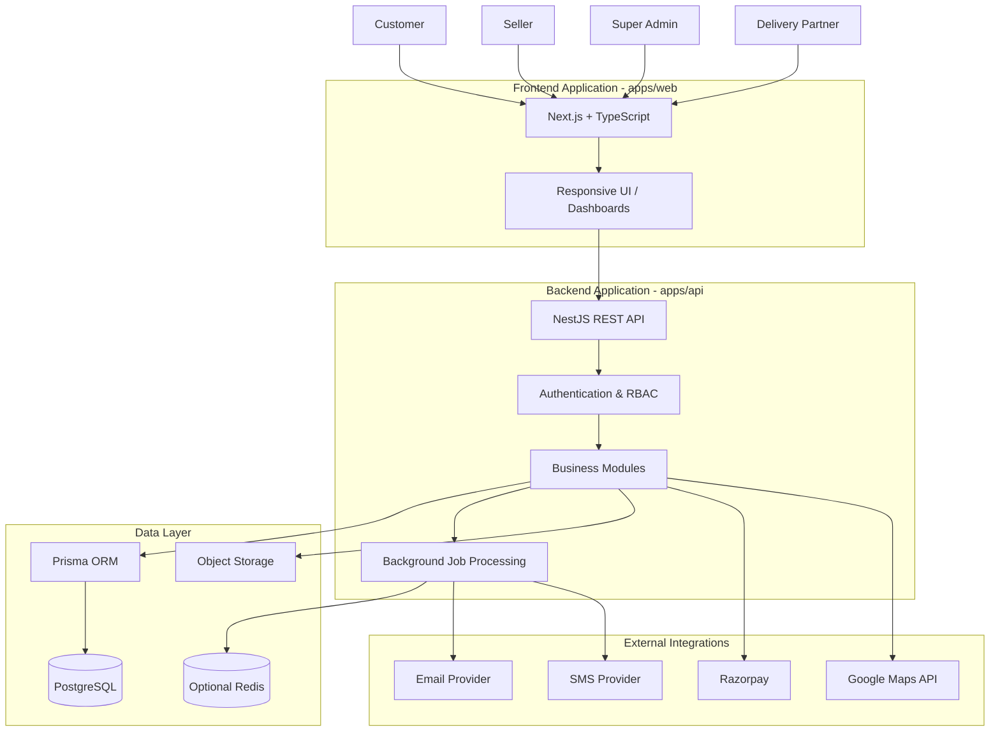

# TECHNICAL_ARCHITECTURE.md

# MARVEL'S BASKET
## Technical Architecture & System Design

| Property | Details |
|---|---|
| Project Name | Marvel's Basket |
| Project ID | MB/MT/2026/001 |
| Client | Marvel's Basket |
| Development Company | Marvel's Techworks |
| Document | TECHNICAL_ARCHITECTURE.md |
| Version | 1.0 |
| Created Date | 19 November 2026 |
| Status | Initial Architecture Draft |

---

# 1. ARCHITECTURE OVERVIEW

## 1.1 Objective

This document defines the complete technical architecture of Marvel's Basket.

The architecture must provide:

- A modern and responsive customer-facing website.
- Independent seller dashboard.
- Super Admin dashboard.
- Delivery Partner dashboard.
- Scalable backend APIs.
- Reliable multi-vendor order processing.
- Transaction-safe inventory management.
- Secure payment processing.
- Location-based seller discovery.
- Future Android and iOS application support.
- Maintainable and modular code organization.

## 1.2 Selected Technology Stack

The following stack is selected as the initial project baseline.

| Layer | Technology |
|---|---|
| Frontend | Next.js |
| Frontend Language | TypeScript |
| UI Styling | Tailwind CSS |
| UI Components | shadcn/ui |
| Backend | NestJS |
| Backend Language | TypeScript |
| API Architecture | REST API |
| Database | PostgreSQL |
| ORM | Prisma |
| Architecture | Monorepo |
| Monorepo Structure | apps/web + apps/api |
| Package Manager | npm |
| Monorepo Build System | npm Workspaces |
| API Documentation | Swagger / OpenAPI |
| Authentication | JWT + Secure HTTP-only Cookies |
| Validation | NestJS DTOs + class-validator |
| Testing | Jest / Playwright |
| Containerization | Docker |
| Version Control | Git + GitHub |

Additional infrastructure and third-party integrations will be finalized during implementation.

## 1.3 Architectural Approach

Marvel's Basket will follow a **Modular Monolith Architecture**.

The frontend and backend will be separate applications inside one monorepository.

The backend will contain independently organized business modules instead of initially splitting functionality into multiple microservices.

This approach provides:

- Clear separation of responsibilities.
- Easier local development.
- Centralized business logic.
- Consistent database transactions.
- Lower infrastructure complexity.
- Easier testing and debugging.
- Future migration to distributed services if required.

---

# 2. HIGH-LEVEL SYSTEM ARCHITECTURE

## 2.1 Architecture Diagram



## 2.2 Application Responsibilities

### Frontend

The Next.js application is responsible for:

- User interfaces.
- Navigation.
- Forms.
- Data presentation.
- Dashboard interfaces.
- Client-side interactions.
- Responsive layouts.
- SEO.
- API communication.

### Backend

The NestJS application is responsible for:

- Authentication.
- Authorization.
- Business logic.
- Database operations.
- Inventory management.
- Order processing.
- Payment verification.
- Commission calculations.
- Delivery management.
- Notifications.
- Reporting.
- API validation.

### Database

PostgreSQL will maintain:

- User accounts.
- Customer information.
- Seller information.
- Products.
- Product listings.
- Inventory.
- Shopping carts.
- Orders.
- Payments.
- Refunds.
- Commissions.
- Settlements.
- Delivery records.
- Notifications.
- Audit logs.

### External Services

External services will handle specialized operations such as:

- Payment processing.
- Maps and geolocation.
- Email communication.
- SMS verification.
- Media storage.

---

# 3. MONOREPO ARCHITECTURE

## 3.1 Repository Structure

The project will use a single Git repository containing frontend, backend and shared packages.

Repository name:

`marvels-basket`

Proposed structure:

```text
marvels-basket/
│
├── apps/
│   │
│   ├── web/
│   │   ├── public/
│   │   ├── src/
│   │   │   ├── app/
│   │   │   │   ├── (storefront)/
│   │   │   │   ├── (auth)/
│   │   │   │   ├── customer/
│   │   │   │   ├── seller/
│   │   │   │   ├── admin/
│   │   │   │   ├── delivery/
│   │   │   │   ├── layout.tsx
│   │   │   │   └── page.tsx
│   │   │   │
│   │   │   ├── components/
│   │   │   │   ├── ui/
│   │   │   │   ├── common/
│   │   │   │   ├── storefront/
│   │   │   │   ├── customer/
│   │   │   │   ├── seller/
│   │   │   │   ├── admin/
│   │   │   │   └── delivery/
│   │   │   │
│   │   │   ├── features/
│   │   │   ├── hooks/
│   │   │   ├── lib/
│   │   │   ├── services/
│   │   │   ├── stores/
│   │   │   ├── types/
│   │   │   └── styles/
│   │   │
│   │   ├── next.config.ts
│   │   ├── package.json
│   │   └── tsconfig.json
│   │
│   └── api/
│       ├── src/
│       │   ├── main.ts
│       │   ├── app.module.ts
│       │   │
│       │   ├── common/
│       │   │   ├── decorators/
│       │   │   ├── guards/
│       │   │   ├── interceptors/
│       │   │   ├── filters/
│       │   │   ├── pipes/
│       │   │   ├── middleware/
│       │   │   └── utils/
│       │   │
│       │   ├── config/
│       │   ├── database/
│       │   │
│       │   ├── modules/
│       │   │   ├── auth/
│       │   │   ├── users/
│       │   │   ├── customers/
│       │   │   ├── sellers/
│       │   │   ├── products/
│       │   │   ├── categories/
│       │   │   ├── inventory/
│       │   │   ├── cart/
│       │   │   ├── checkout/
│       │   │   ├── orders/
│       │   │   ├── payments/
│       │   │   ├── refunds/
│       │   │   ├── commissions/
│       │   │   ├── settlements/
│       │   │   ├── deliveries/
│       │   │   ├── locations/
│       │   │   ├── reviews/
│       │   │   ├── offers/
│       │   │   ├── notifications/
│       │   │   ├── reports/
│       │   │   └── admin/
│       │   │
│       │   └── jobs/
│       │
│       ├── test/
│       ├── nest-cli.json
│       ├── package.json
│       └── tsconfig.json
│
├── packages/
│   ├── database/
│   │   ├── prisma/
│   │   │   ├── schema.prisma
│   │   │   ├── migrations/
│   │   │   └── seed.ts
│   │   └── package.json
│   │
│   ├── api-client/
│   │   └── package.json
│   │
│   ├── shared-types/
│   │   └── package.json
│   │
│   ├── config/
│   │   ├── eslint/
│   │   ├── typescript/
│   │   └── package.json
│   │
│   └── utils/
│
├── docs/
│   ├── PROJECT_CONTEXT.md
│   ├── PROJECT_REQUIREMENTS.md
│   ├── TECHNICAL_ARCHITECTURE.md
│   ├── DATABASE_SCHEMA.md
│   ├── PROJECT_STATUS.md
│   ├── PROJECT_DECISIONS.md
│   └── IMPLEMENTATION_PHASES.md
│
├── scripts/
│
├── docker/
│
├── .github/
│   └── workflows/
│
├── .env.example
├── .gitignore
├── docker-compose.yml
├── package.json
├── pnpm-workspace.yaml
├── turbo.json
└── README.md
```

The structure may evolve as modules grow, but the primary application boundaries must remain clear.

## 3.2 Workspace Management

The monorepo will use:

- pnpm workspaces for package management.
- Turborepo for task orchestration.
- TypeScript for application and shared package development.

Root scripts should support:

```bash
pnpm dev
pnpm build
pnpm lint
pnpm typecheck
pnpm test
pnpm format
```

Application-specific commands:

```bash
pnpm --filter web dev
pnpm --filter api dev
pnpm --filter web build
pnpm --filter api build
```

## 3.3 Shared Packages

### packages/database

Responsible for:

- Prisma schema.
- Database migrations.
- Prisma Client generation.
- Database seed scripts.
- Shared database package configuration.

Only the backend should directly access the database in production.

The frontend must never import Prisma Client or connect directly to PostgreSQL.

### packages/api-client

Responsible for:

- Generated TypeScript API client.
- API endpoint definitions.
- Shared API request configuration.
- Typed API responses.

The client should be generated from the backend's OpenAPI specification.

### packages/shared-types

Responsible for safe, frontend-compatible shared types and constants.

It must not expose sensitive backend implementation details or database-only models.

### packages/config

Responsible for:

- Shared TypeScript configuration.
- ESLint configuration.
- Formatting configuration.
- Common development standards.

---

# 4. FRONTEND ARCHITECTURE

## 4.1 Technology

| Technology | Responsibility |
|---|---|
| Next.js | React application framework |
| TypeScript | Static typing |
| Tailwind CSS | Styling |
| shadcn/ui | Reusable UI components |
| React Hook Form | Form management |
| Zod | Client-side schema validation |
| TanStack Query | Server-state management |
| Zustand | Lightweight client-state management |
| Lucide Icons | Icon system |
| Playwright | E2E testing |

The exact library versions will be pinned during project initialization.

## 4.2 Application Sections

The frontend will contain four primary application areas.

### A. Customer Storefront

Routes:

```text
/
├── /categories
├── /categories/[slug]
├── /products
├── /products/[slug]
├── /sellers
├── /sellers/[slug]
├── /search
├── /cart
├── /checkout
├── /orders
├── /orders/[id]
├── /wishlist
├── /profile
├── /addresses
├── /offers
└── /help
```

Responsibilities:

- Product discovery.
- Seller discovery.
- Shopping.
- Checkout.
- Order tracking.
- Customer account management.

### B. Customer Account

Responsibilities:

- Authentication.
- Profile management.
- Address management.
- Order history.
- Wishlist.
- Reviews.

### C. Seller Dashboard

Routes:

```text
/seller
├── /dashboard
├── /onboarding
├── /shop
├── /products
├── /products/new
├── /inventory
├── /orders
├── /orders/[id]
├── /analytics
├── /earnings
├── /settlements
└── /settings
```

### D. Super Admin Dashboard

Routes:

```text
/admin
├── /dashboard
├── /customers
├── /sellers
├── /sellers/[id]
├── /products
├── /categories
├── /orders
├── /payments
├── /refunds
├── /commissions
├── /settlements
├── /delivery-partners
├── /deliveries
├── /coupons
├── /banners
├── /reports
├── /admins
├── /audit-logs
└── /settings
```

### E. Delivery Partner Interface

Routes:

```text
/delivery
├── /dashboard
├── /onboarding
├── /assignments
├── /assignments/[id]
├── /history
├── /earnings
└── /profile
```

## 4.3 Frontend Rendering Strategy

Use rendering methods according to the purpose of each page.

| Page Type | Rendering Strategy |
|---|---|
| Homepage | Server Components |
| Category pages | Server Components |
| Product pages | Server Components |
| Seller pages | Server Components |
| Search | Server + Client Components |
| Cart | Client Components |
| Checkout | Client + Server |
| Dashboards | Server + Client |
| Authentication | Server + Client |
| Order tracking | Client + Server |

SEO-sensitive pages must use appropriate metadata, structured content and server rendering.

## 4.4 State Management

Different types of state must be handled separately.

### Server State

Use TanStack Query for:

- Products.
- Categories.
- Sellers.
- Orders.
- Inventory.
- Reports.
- Notifications.

### Client State

Use Zustand for lightweight UI and temporary application state:

- Shopping cart UI.
- Selected filters.
- Modal state.
- Navigation state.
- Temporary preferences.

Important business data must always be validated against the backend.

The frontend cart must never be treated as the authoritative source of prices or inventory.

## 4.5 UI Architecture

The UI should follow a reusable component-based design system.

Recommended structure:

- Layout components.
- Navigation components.
- Form components.
- Data table components.
- Dashboard cards.
- Product cards.
- Seller cards.
- Cart components.
- Checkout components.
- Status badges.
- Modal and dialog components.

The storefront and dashboards should share design tokens and reusable primitives without forcing identical layouts.

---

# 5. BACKEND ARCHITECTURE

## 5.1 Technology

| Technology | Responsibility |
|---|---|
| NestJS | Backend framework |
| TypeScript | Backend language |
| REST | API communication |
| Prisma | ORM |
| PostgreSQL | Database |
| class-validator | Request validation |
| class-transformer | DTO transformation |
| Swagger | API documentation |
| Jest | Unit and integration testing |
| Argon2id | Password hashing |
| JWT | Access authentication |
| Docker | Containerization |

## 5.2 Backend Architecture Pattern

Each business module should follow a layered structure.

Example:

```text
modules/
└── products/
    ├── products.module.ts
    ├── products.controller.ts
    ├── products.service.ts
    ├── products.repository.ts
    ├── dto/
    │   ├── create-product.dto.ts
    │   ├── update-product.dto.ts
    │   └── query-product.dto.ts
    ├── interfaces/
    ├── policies/
    └── tests/
```

Responsibilities:

### Controller

- Defines API endpoints.
- Receives requests.
- Applies guards and validation.
- Returns structured responses.

### Service

- Implements business logic.
- Coordinates related operations.
- Enforces business rules.
- Manages transactions where required.

### Repository

- Encapsulates database queries.
- Handles data persistence.
- Provides reusable data-access methods.

For simpler modules, the service may use Prisma directly. A separate repository layer should be introduced when it provides meaningful isolation or reuse rather than being mandatory boilerplate.

### DTO

- Validates incoming data.
- Defines API input contracts.
- Prevents unexpected fields from reaching business logic.

## 5.3 Core Backend Modules

| Module | Responsibility |
|---|---|
| Auth | Authentication and sessions |
| Users | Common user management |
| Customers | Customer-specific operations |
| Sellers | Seller onboarding and shop management |
| Products | Product catalog |
| Categories | Category management |
| Inventory | Stock and inventory transactions |
| Cart | Shopping cart |
| Checkout | Checkout validation and order initiation |
| Orders | Parent and seller order management |
| Payments | Payment gateway integration |
| Refunds | Refund operations |
| Commissions | Commission calculations |
| Settlements | Seller financial settlements |
| Deliveries | Delivery assignments and tracking |
| Locations | Address and serviceability |
| Reviews | Ratings and reviews |
| Offers | Coupons and promotions |
| Notifications | Notification delivery |
| Reports | Analytics and reports |
| Admin | Administrative operations |

## 5.4 Modular Boundaries

Modules must not bypass other modules to modify their private business data.

For example:

- Checkout coordinates cart, inventory, pricing, order and payment modules.
- Orders coordinate seller fulfilment and delivery modules.
- Payments coordinate payment gateway operations and financial records.
- Commissions calculate financial deductions based on approved transaction data.

Module interactions should use clearly defined service interfaces and events where appropriate.

## 5.5 Backend Foundation & Global Infrastructure Standards (Phase 02)

### 1. Application Bootstrap & Routing
- **Base Route Prefix:** `/api`
- **URI Versioning:** `VersioningType.URI` with default version `1` producing `/api/v1/*`.
- **Security:** Helmet HTTP security headers (CSP, HSTS, X-Content-Type-Options, Frameguard), express body limits (`10mb`).
- **CORS:** Configurable allowed origins, strict HTTP methods (`GET, HEAD, PUT, PATCH, POST, DELETE, OPTIONS`), credentials enabled.
- **Graceful Shutdown:** `enableShutdownHooks()` ensuring active database connections and Redis sockets close cleanly upon `SIGINT`/`SIGTERM`.

### 2. Request Correlation & Observability
- **Correlation ID Middleware:** Extracts incoming `x-correlation-id` or `x-request-id` header (sanitized via regex `^[a-zA-Z0-9_-]{8,64}$`) or generates a UUID v4. Sets response header and attaches to request context.
- **Structured Request Logging:** `LoggingInterceptor` captures execution latency, HTTP method, URL, status code, and correlation ID. Sensitive parameters (passwords, tokens, payment secrets) are masked.

### 3. API Response & Error Standards
- **Standard Success Envelope (`TransformInterceptor`):**
  Wraps controller returns in `{ success: true, statusCode, message, data, meta?, timestamp, path, correlationId }`. Supports `@ResponseMessage('Custom message')` and `@BypassTransform()` for streaming/raw payloads.
- **Centralized Exception Handling (`AllExceptionsFilter`):**
  Intercepts NestJS `HttpException`, class-validator `BadRequestException`, Prisma `PrismaClientKnownRequestError` (P2002, P2025, P2003), and unhandled runtime errors into `{ success: false, statusCode, code, message, errors?, timestamp, path, correlationId }`.

### 4. Typed Configuration & Fail-Fast Validation
- Coupled with **Joi validation schema** enforcing required environment variables (`DATABASE_URL`, `JWT_SECRET` min 32 chars, valid ports, enums).
- Application halts bootstrap with explicit diagnostic errors if configuration is invalid.

### 5. Database & Cache Services
- **`PrismaService` (`@Global()` in `PrismaModule`):** Extends `PrismaClient` with `onModuleInit` connection lifecycle, `onModuleDestroy` disconnection, and `isHealthy()` raw SQL query probe.
- **`RedisService` (`@Global()` in `RedisModule`):** Wraps `ioredis` with automatic exponential retry strategy, connection listeners, graceful `quit()`, and `ping()` health probe.

### 6. Dual-Probe Health Monitoring System
- `GET /api/v1/health`: Overall health summary, uptime, version, and memory usage.
- `GET /api/v1/health/live`: Liveness probe for process supervisors.
- `GET /api/v1/health/ready`: Readiness probe actively querying PostgreSQL (`SELECT 1`) and Redis (`PING`). Returns HTTP 200 when all healthy; throws HTTP 503 (`ServiceUnavailableException`) with component breakdown if degraded.

### 7. OpenAPI / Swagger Documentation
- Accessible at `/api/docs` (Swagger UI) and `/api/docs-json` (OpenAPI 3.0 specification).
- Controlled by `SWAGGER_ENABLED` environment variable. Includes Bearer JWT auth definitions and tagged endpoints.

---

# 6. DATABASE ARCHITECTURE

## 6.1 Database Selection

PostgreSQL will be the primary relational database.

Reasons:

- Strong relational integrity.
- ACID transactions.
- Reliable concurrent writes.
- Advanced indexing.
- JSONB support.
- Geospatial extension compatibility.
- Mature production ecosystem.

## 6.2 ORM

Prisma will be used for:

- Schema definitions.
- Database access.
- Type-safe queries.
- Migrations.
- Database client generation.
- Relational operations.

Prisma migrations must be version-controlled.

Production schema changes must be applied through reviewed migrations.

## 6.3 Database Design Principles

1. Use normalized relational models where appropriate.
2. Use explicit primary keys.
3. Enforce foreign key relationships.
4. Add indexes for frequent queries.
5. Use appropriate unique constraints.
6. Store monetary values using Decimal types.
7. Store timestamps consistently in UTC.
8. Preserve historical order information.
9. Maintain inventory transaction history.
10. Avoid destructive financial updates.
11. Use database transactions for critical operations.
12. Use soft deletion selectively.

## 6.4 Major Database Domains

### Identity

- User.
- Role.
- Permission.
- UserRole.
- Session.
- VerificationToken.

### Customer

- CustomerProfile.
- CustomerAddress.
- Wishlist.
- WishlistItem.

### Seller

- Seller.
- SellerProfile.
- SellerKYC.
- SellerDocument.
- SellerBusinessHours.
- SellerServiceArea.

### Catalog

- Category.
- Product.
- ProductImage.
- ProductVariant.
- SellerProduct.
- ProductAttribute.

### Inventory

- Inventory.
- InventoryTransaction.
- StockReservation.

### Shopping

- Cart.
- CartItem.

### Orders

- Order.
- SellerOrder.
- OrderItem.
- OrderStatusHistory.

### Payments

- Payment.
- PaymentTransaction.
- Refund.
- RefundTransaction.

### Finance

- CommissionRule.
- CommissionRecord.
- SellerEarning.
- Settlement.
- SettlementItem.

### Delivery

- DeliveryPartner.
- DeliveryAssignment.
- Delivery.
- DeliveryStatusHistory.

### Marketing

- Coupon.
- CouponUsage.
- Banner.
- Promotion.

### Engagement

- Review.
- Notification.
- NotificationPreference.

### Administration

- AdminActivityLog.
- AuditLog.
- PlatformSetting.

The detailed model definitions, fields, enums and relationships will be documented in DATABASE_SCHEMA.md.

## 6.5 Multi-Vendor Data Model

The marketplace must distinguish between a shared product catalog and seller-specific product listings.

Example:

```text
Product
  ├── Rice
  │
  ├── SellerProduct
  │    ├── Seller A - ₹120 - Stock 20
  │    ├── Seller B - ₹115 - Stock 10
  │    └── Seller C - ₹125 - Stock 30
  │
  └── ProductVariant
```

The Product represents the catalog item.

SellerProduct represents a seller's independent offer, price and inventory.

This separation is essential for multi-vendor operations.

## 6.6 Single-Store Order Architecture

In the MVP, every checkout and order is strictly single-store. A customer selects products from exactly one store at a time.

Structure:

```text
Customer
   │
   └── Cart (Single Store: Store A)
         │
         └── Checkout
               │
               └── Order (Store A)
                     ├── OrderItem 1 (Basmati Rice - Price Snapshot)
                     ├── OrderItem 2 (Milk 1L - Price Snapshot)
                     ├── Payment (Razorpay / COD)
                     └── Delivery (Platform-Managed Delivery)
```

The `Order` entity maps directly to that store (`sellerId`), customer, frozen delivery address snapshot, items (`OrderItem`), payment record, and platform-managed delivery record.

This eliminates parent/child order orchestration bugs, atomic multi-order status aggregation overhead, and complex multi-seller split liabilities during the MVP launch. Multi-seller split orders are deferred to a post-MVP architecture if ever required.

## 6.7 Database Implementation & Operational Tooling (Phase 03)

### 6.7.1 Technology Stack & Topology
- **Engine:** PostgreSQL 16 on Docker container `marvels_basket_postgres` (host port 5433).
- **ORM & Client:** Prisma ORM 5.22 with `@prisma/client` generated to root `node_modules/@prisma/client`.
- **Database Access:** Encapsulated inside `apps/api/src/database/prisma.service.ts` inheriting `PrismaClient` with `onModuleInit`, `onModuleDestroy`, and raw health probe `isHealthy()`.

### 6.7.2 Applied Migrations (Version Controlled)
1. `20261119074339_init`: Created the full 54-table relational foundation, foreign keys, cascades, indexes, and initial enums.
2. `20261119074630_role_and_payment_enums`: Bound `UserRoleType` to `Role.roleType` and `PaymentMethod` to `Payment.paymentMethod`.
3. `20261119075000_seller_product_null_variant_unique`: Added PostgreSQL partial unique index `CREATE UNIQUE INDEX "seller_products_seller_id_product_id_null_variant_key" ON "seller_products"("seller_id", "product_id") WHERE "variant_id" IS NULL;` ensuring strict uniqueness for non-variant store listings.

### 6.7.3 Root-Level Database Tooling
| Command | Action |
|---|---|
| `npm run db:validate` | Validates `apps/api/prisma/schema.prisma` syntax and relation integrity. |
| `npm run db:format` | Formats the Prisma schema with canonical indentation. |
| `npm run db:generate` | Generates the typed Prisma Client into `node_modules/@prisma/client`. |
| `npm run db:migrate` | Runs interactive development migrations (`prisma migrate dev`). |
| `npm run db:migrate:deploy` | Applies unapplied versioned migrations in CI/CD and production (`prisma migrate deploy`). |
| `npm run db:seed` | Executes deterministic, idempotent development database seed (`apps/api/prisma/seed.ts`). |
| `npm run db:status` | Inspects migration sync status against PostgreSQL. |
| `npm run db:test` | Executes database integrity and marketplace invariant test suite (`apps/api/test/database-integrity.db-spec.ts`). |
| `npm run db:studio` | Launches web-based visual data inspector Prisma Studio. |

---

# 7. AUTHENTICATION AND AUTHORIZATION ARCHITECTURE

## 7.1 Differentiated Authentication Strategy

The platform implements differentiated authentication architectures based on user role and UX convenience:

1. **Customers & Delivery Partners: Mobile Phone Number + OTP**
   - High-conversion, friction-free login without passwords.
   - 6-digit numeric OTP delivered via SMS gateway (Fast2SMS / MSG91).
   - OTP stored in Redis with 5-minute TTL (300 seconds).
   - Rate limiting: max 5 requests/hour per phone, 60-second cooldown between requests.
   - Brute-force protection: max 3 verification attempts per OTP; account locked for 15 minutes after 5 failed attempts.
   - Auto-creates `CustomerProfile` on first verified login.

2. **Sellers & Administrators: Email + Password Authentication**
   - Traditional credential authentication for desktop dashboard users.
   - Passwords hashed using Argon2id (memory cost 64MB, 3 iterations, parallelism 1).
   - Administrative login enforces role-level security with future MFA readiness.

## 7.2 Token & Session Architecture

The API uses stateless JWT access tokens combined with stateful rotating refresh tokens:

### Access Token
- Short-lived JWT (15 minutes).
- Payload: `{ sub: userId, role: UserRoleType, sellerId?: string, sessionVersion: number }`.
- Verified statelessly in NestJS `JwtAuthGuard` using public key / secret.
- Delivered in `Authorization: Bearer <token>` or secure cookie.

### Refresh Token & Session Management
- Long-lived token (7 days).
- Stored as a cryptographic SHA-256 hash in the database `Session` table.
- Delivered exclusively via `HttpOnly`, `Secure`, `SameSite=Strict` cookies to mitigate XSS attacks.
- **Refresh Token Rotation:** On every token refresh, the used refresh token is invalidated, and a new refresh token + access token pair is issued.
- **Reuse Detection:** If an already-revoked refresh token hash is presented, the system immediately revokes all active sessions for that user (mitigating token theft).
- Explicit logout destroys the session record in PostgreSQL and clears the cookie.

## 7.3 Cookie Security

Cookies must use:

- HttpOnly.
- Secure in production.
- Appropriate SameSite policy.
- Restricted path.
- Appropriate expiration.

The production routing should use a same-origin API proxy or reverse proxy where practical, allowing host-only secure cookies.

If cross-origin cookies are required, CORS, cookie domains and CSRF protections must be configured explicitly.

## 7.4 Role-Based Access Control

Initial roles:

```text
CUSTOMER
SELLER
DELIVERY_PARTNER
ADMIN
SUPER_ADMIN
```

Permissions must be checked by NestJS guards and backend policies.

Frontend route protection is only a user experience measure. It must never replace backend authorization.

## 7.5 Seller Data Isolation

Every seller-owned operation must validate seller ownership on the backend.

Example:

```text
Authenticated Seller
       |
       v
Request: Update Product
       |
       v
Verify Seller Identity
       |
       v
Verify Product Ownership
       |
       v
Validate Permissions
       |
       v
Execute Operation
```

Changing a seller ID in a request must never grant access to another seller's resources.

---

# 8. API ARCHITECTURE

## 8.1 Communication Protocol

The frontend and backend will communicate through REST APIs over HTTPS.

Base URL:

```text
/api/v1
```

Example:

```text
GET    /api/v1/products
GET    /api/v1/products/:id
POST   /api/v1/products
PATCH  /api/v1/products/:id
DELETE /api/v1/products/:id
```

## 8.2 API Standards

All APIs must implement:

- Versioning.
- Request validation.
- Authentication.
- Authorization.
- Pagination where appropriate.
- Filtering.
- Sorting.
- Consistent response structures.
- Consistent error handling.
- Structured logging.

## 8.3 Response Format

Success response:

```json
{
  "success": true,
  "message": "Products retrieved successfully",
  "data": [],
  "meta": {
    "page": 1,
    "limit": 20,
    "total": 0
  }
}
```

Error response:

```json
{
  "success": false,
  "message": "Validation failed",
  "code": "VALIDATION_ERROR",
  "errors": []
}
```

Sensitive internal error information must never be exposed to clients.

## 8.4 API Documentation

NestJS Swagger integration will generate OpenAPI documentation.

Documentation must include:

- Endpoint descriptions.
- Request schemas.
- Response schemas.
- Authentication requirements.
- Error responses.
- Example payloads.

Development API documentation:

```text
/api/docs
```

Production API documentation must have appropriate access restrictions.

## 8.5 Frontend API Communication

The frontend will use a typed API client generated from the OpenAPI specification.

The frontend must not directly query the database.

Next.js Server Components and Client Components should use the appropriate server-side or browser-side API communication method.

Business logic must remain in NestJS.

---

# 9. SINGLE-STORE ORDER PROCESSING & CHECKOUT ARCHITECTURE

Order processing and checkout are designed around a single-store transaction boundary.

## 9.1 Checkout Flow

```mermaid
flowchart TD
    A[Customer Checkout] --> B[Validate Single-Store Cart]
    B --> C[Validate Delivery Address & Store Radius]
    C --> D[Check Store Operational Status & Hours]
    D --> E[Validate Product Prices vs MRP]
    E --> F[Check Inventory Availability]
    F --> G[Calculate MOV, Platform Coupons & Delivery Fee]
    G --> H[Create Atomic Inventory Reservation (15 min TTL)]
    H --> I[Create Order (PENDING) & Payment Record]
    I --> J{Payment Method}
    J -->|Online: Razorpay| K[Create Razorpay Order]
    J -->|COD| L[Validate COD Limits & Confirm Order]
    K --> M[Customer Completes Payment]
    M --> N[Cryptographic Signature / Webhook Verification]
    N -->|Valid| O[Commit Stock Reservation & Mark Order CONFIRMED]
    N -->|Invalid / Failed| P[Release Stock Reservation & Mark Order FAILED]
    O --> Q[Notify Store to Begin Packing]
    L --> Q
```

## 9.2 Atomic Inventory Reservation

To prevent race conditions, overselling, or ghost locks:
- Reservation occurs during the checkout transition (`Proceed to Payment`).
- Execution uses an atomic PostgreSQL transaction with row-level locks (`SELECT FOR UPDATE`) or atomic conditional update:
  ```sql
  UPDATE "Inventory"
  SET "availableQuantity" = "availableQuantity" - :qty,
      "reservedQuantity" = "reservedQuantity" + :qty
  WHERE "sellerProductId" = :id AND "availableQuantity" >= :qty;
  ```
- Creates a `StockReservation` record with `expiresAt = NOW() + INTERVAL '15 minutes'`.
- A BullMQ delayed job schedules a sweep at `expiresAt`. If `status == 'ACTIVE'`, the worker automatically releases the reserved stock and marks the reservation `EXPIRED`.
- On verified payment success, `StockReservation` is updated to `COMMITTED`, and `reservedQuantity` is permanently decremented.

## 9.3 Payment & Webhook Processing

- Backend calls Razorpay Orders API:
  - Amount in paise (integer precision).
  - Currency: `INR`.
  - Receipt ID: internal `orderId`.
- Response returns `razorpay_order_id` to client checkout modal.
- Client completion returns `razorpay_payment_id` and `razorpay_signature`.
- Server Verification:
  - Backend verifies HMAC-SHA256 signature against `RAZORPAY_KEY_SECRET`.
  - Upon valid signature, updates `Payment` to `SUCCESS` and `Order` to `CONFIRMED`.
- Webhook Fail-Safe:
  - Razorpay webhooks (`order.paid`, `payment.failed`, `refund.processed`) deliver asynchronous confirmation.
  - Raw body signature checked against `RAZORPAY_WEBHOOK_SECRET`.
  - Idempotency check against `PaymentWebhookEvent`: duplicate webhook events are logged and ignored with HTTP 200.

## 9.4 Store Fulfillment & Delivery Handoff

1. Order Confirmed: Store receives audio/visual alert on seller dashboard.
2. Order Packing: Store prepares goods, prints receipt, and clicks "Mark Packed".
3. State Transition: Order moves to `PACKED` (`READY_FOR_PICKUP`).
   - Customer self-service cancellation is locked.
   - Dispatch event emitted to `DeliveryModule`.
4. Platform Delivery Dispatch: System identifies available platform delivery partner and assigns delivery task.
5. Store Handover: Delivery partner arrives, inspects package, verifies order number snapshot, and marks `PICKED_UP`. Order moves to `OUT_FOR_DELIVERY`.

## 9.5 Store Fulfillment Exceptions

- Store Rejection: If merchant is unable to fulfill (e.g., unexpected physical inventory damage), store rejects order within acceptance SLA. Order moves to `REJECTED`, 100% full source refund is initiated, and stock reservations are released.
- Out of Stock during Packing: If an item is missing, store flags item before packing. System offers customer:
  1. Accept partial shipment (order total recalculated, partial source refund initiated).
  2. Cancel entire order with full source refund.
- Delivery Failure: If customer is unreachable, parcel returns to store (RTO). Store acknowledges return of items; customer service assesses redelivery or cancellation.

---

# 10. PAYMENT AND FINANCIAL ARCHITECTURE

## 10.1 Payment Provider & Modular Abstraction

Initial provider: **Razorpay**  
All payment interactions are abstracted behind an `IPaymentService` interface:
```typescript
export interface IPaymentService {
  createPaymentOrder(order: Order): Promise<PaymentOrderResult>;
  verifyPaymentSignature(payload: PaymentVerificationDto): Promise<boolean>;
  verifyWebhookSignature(rawBody: Buffer, signature: string): Promise<boolean>;
  initiateRefund(paymentId: string, amount: Decimal, reason: string): Promise<RefundResult>;
}
```

### Marketplace Settlement & Route Capabilities
- **Important Constraint:** Do NOT assume Razorpay Route (automated split settlements) is active or available. Route requires separate merchant agreements, compliance scrutiny, and operational overhead.
- **MVP Settlement Strategy:**
  1. All customer online payments are captured centrally into Marvel's Basket primary business account via Razorpay standard gateway.
  2. The backend financial module maintains an internal double-entry financial ledger (`SellerLedgerEntry`).
  3. Seller earnings are calculated per delivered order after deducting category commission.
  4. Payouts are aggregated into batch settlements (`SettlementBatch`) after a T+3 business day retention period.
  5. Payout disbursement is executed via automated bank transfer (Razorpay Payouts API / NEFT / IMPS batch upload) once commercial arrangements are authorized.

## 10.2 Financial Separation & Cost Allocation

The financial engine cleanly isolates:
1. `grossAmount`: Total item value at store selling price (`SUM(quantity * sellingPrice)`).
2. `commissionAmount`: Platform earnings (`grossAmount * categoryCommissionRate`).
3. `deliveryFee`: Paid by customer, allocated to delivery fleet / provider operations.
4. `couponDiscount`: Platform-funded promotional discounts; does not reduce seller earnings.
5. `storeDiscount`: Seller-funded difference between MRP and selling price.
6. `refundDeductions`: Product quality returns debited 100% from seller ledger; transit damages absorbed by platform.
7. `netSellerPayable`: `grossAmount - commissionAmount - refundDeductions`.

## 10.3 Financial Ledger Integrity

- Storage: All monetary amounts stored using PostgreSQL `DECIMAL(12, 2)` (never JavaScript `Number` or Float).
- Immutability: Once an order reaches `DELIVERED`, financial records are posted as immutable `SellerLedgerEntry` rows.
- Reconcilable: Every settlement batch links directly to discrete ledger entries via `SettlementItem`. Historical order changes cannot alter settled ledger entries.
- Holds: Automated payout holds enforced for open customer disputes, unverified bank accounts, or negative ledger balances.

---

# 11. LOCATION AND GEOLOCATION ARCHITECTURE

## 11.1 Proposed Integration

Google Maps Platform or an equivalent mapping provider.

Potential services:

- Geocoding.
- Reverse geocoding.
- Place selection.
- Distance calculation.
- Map visualization.

## 11.2 Location Storage

Customer addresses must support:

- Full address.
- PIN code.
- Latitude.
- Longitude.
- Landmark.
- City.
- State.
- Country.

Seller records must support shop location and delivery coverage.

## 11.3 Serviceability

Serviceability will initially be based on configurable seller service areas.

Potential methods:

- PIN code matching.
- Configured delivery zones.
- Seller delivery radius.
- Geographic distance.

PostGIS may be introduced for efficient geographic queries as location-based requirements grow.

The final geospatial implementation will be determined during database design.

## 11.4 Delivery Estimates

Estimated delivery time may consider:

- Seller preparation time.
- Distance.
- Delivery partner availability.
- Operating hours.
- Delivery workload.

The estimate should be configurable and should not depend exclusively on straight-line distance.

---

# 12. FILE AND MEDIA STORAGE

## 12.1 Storage Strategy

Product images, seller documents, banners and other media must be stored in external object storage.

The application database should store metadata and file references, not binary image data.

## 12.2 Media Categories

- Product images.
- Product variant images.
- Seller logos.
- Seller banners.
- Seller KYC documents.
- Delivery partner documents.
- Promotional banners.
- Category images.

## 12.3 Upload Architecture

```text
Frontend
   |
   v
Backend Upload Authorization
   |
   v
Storage Provider
   |
   v
Validate Upload
   |
   v
Save File Metadata
   |
   v
PostgreSQL
```

Direct-to-storage uploads using short-lived signed URLs may be used for larger files.

## 12.4 Security

- Validate file type.
- Validate file size.
- Restrict allowed formats.
- Generate safe object names.
- Prevent unauthorized document access.
- Restrict sensitive KYC document access.
- Use signed URLs for private files.
- Never expose private documents through public URLs.

The storage provider remains subject to infrastructure approval.

---

# 13. BACKGROUND JOBS AND ASYNCHRONOUS PROCESSING

Certain operations should not block normal API requests.

Potential background tasks:

- Email notifications.
- SMS notifications.
- Order notifications.
- Seller alerts.
- Payment webhook follow-up processing.
- Reservation expiration.
- Settlement reports.
- Scheduled cleanup.
- Analytics aggregation.

## 13.1 Proposed Architecture

A Redis-backed job queue such as BullMQ may be introduced when background processing is required.

```text
NestJS API
    |
    v
Job Producer
    |
    v
Redis Queue
    |
    v
Background Worker
    |
    v
External Provider / Database
```

## 13.2 Reliability

- Retry failed jobs where appropriate.
- Use exponential backoff.
- Record job failures.
- Avoid duplicate business operations.
- Implement idempotency.
- Monitor queue health.
- Use dead-letter handling for permanently failed jobs.

For critical order and payment events, the architecture should use durable event recording, such as an outbox pattern, to prevent database commits from being separated from event publication.

Redis is an optional infrastructure component until its adoption is formally approved.

---

# 14. NOTIFICATION ARCHITECTURE

Notification channels:

- In-app notifications.
- Email.
- SMS.
- Future push notifications.

Proposed processing:

```text
Business Event
     |
     v
Notification Service
     |
     v
Notification Job
     |
     v
Background Worker
     |
     v
Email / SMS / In-App
```

The notification service must be independent of individual business modules.

Example events:

- ORDER_CREATED.
- ORDER_CONFIRMED.
- SELLER_ORDER_ACCEPTED.
- ORDER_READY_FOR_PICKUP.
- ORDER_DELIVERED.
- PAYMENT_SUCCESS.
- PAYMENT_FAILED.
- REFUND_UPDATED.
- SELLER_APPROVED.

Notification failures must not incorrectly reverse successful financial or order operations.

---

# 15. SECURITY ARCHITECTURE

Security must be implemented across all application layers.

## 15.1 Application Security

- HTTPS.
- Secure authentication.
- Password hashing with Argon2id.
- Role-based authorization.
- Request validation.
- Rate limiting.
- Secure headers.
- CORS restrictions.
- CSRF protection where cookie-based authentication requires it.
- Secure file uploads.
- Protection against common OWASP vulnerabilities.

## 15.2 Database Security

- Restricted database credentials.
- Environment-based secrets.
- Least-privilege access.
- Database backups.
- Migration control.
- Transaction safety.
- Audit logging.

## 15.3 Payment Security

- Backend payment verification.
- Webhook signature verification.
- Idempotent processing.
- Secure provider credentials.
- No storage of raw card information.
- Transaction history.

## 15.4 Data Protection

- Restrict access to personal information.
- Protect KYC documents.
- Avoid logging passwords and tokens.
- Apply appropriate retention policies.
- Record sensitive administrative actions.
- Support account deactivation without destroying financial history.

---

# 16. INFRASTRUCTURE AND DEPLOYMENT ARCHITECTURE

## 16.1 Deployment Structure

The initial deployment will contain independently deployable frontend and backend applications.

Proposed production domains:

```text
marvelsbasket.com
    |
    └── Customer Website

api.marvelsbasket.com
    |
    └── NestJS API

marvelsbasket.com/seller
    |
    └── Seller Dashboard

marvelsbasket.com/admin
    |
    └── Admin Dashboard

marvelsbasket.com/delivery
    |
    └── Delivery Partner Interface
```

The final domain names are subject to domain availability and client approval.

## 16.2 Hosting & Infrastructure Evaluation

The platform will be deployed as a **Containerized Modular Monolith** inside a unified monorepo.

### Deployment Options Evaluation

| Provider / Setup | Reliability & SLA | Cost Efficiency | Database & Backups | Background Jobs & Redis | Production Assessment |
|---|---|---|---|---|---|
| **Render** (Recommended for MVP) | High (automated health checks, zero-downtime deploys) | High (predictable monthly compute tiers, low entry barrier) | Managed PostgreSQL with automated daily backups & point-in-time recovery | Managed Redis + Webhook background workers | **Strong Candidate for MVP:** Low operational overhead, native Docker support, easy secrets management, fast rollback. |
| **AWS (ECS / RDS)** | Enterprise-grade (multi-AZ availability) | Moderate to High (higher minimum baseline costs, egress fees) | AWS RDS PostgreSQL with automated snapshots & read replicas | ElastiCache Redis | **Target for Scaled Stage:** Ideal when order volume exceeds 5,000/day and dedicated DevOps engineering is available. |
| **Railway** | High for developer velocity | High for early testing | Managed PostgreSQL | Managed Redis | **Alternative for MVP:** Excellent staging and preview environment support. |

### Containerization Strategy

- Dockerfile for `apps/api` (Multi-stage build: base, dependencies, build, production runner).
- Dockerfile for `apps/web` (Next.js standalone output mode with runner user).
- `docker-compose.yml` for local development orchestrating:
  - PostgreSQL 16
  - Redis 7
  - MinIO / Local storage emulator
  - API & Web containers

## 16.3 Docker

Docker will be used for consistent development and deployment environments.

Local development may include:

- PostgreSQL.
- Redis, when adopted.
- NestJS API.
- Next.js frontend.

Docker Compose will manage local supporting infrastructure.

Production deployment may use separate application containers.

## 16.4 Environment Configuration

Environment-specific configurations:

```text
.env.example
.env.development
.env.test
.env.production
```

Sensitive environment files must never be committed to Git.

Example variables:

```env
NODE_ENV=
PORT=

DATABASE_URL=

JWT_ACCESS_SECRET=
JWT_REFRESH_SECRET=

RAZORPAY_KEY_ID=
RAZORPAY_KEY_SECRET=
RAZORPAY_WEBHOOK_SECRET=

GOOGLE_MAPS_API_KEY=

STORAGE_ENDPOINT=
STORAGE_ACCESS_KEY=
STORAGE_SECRET_KEY=
STORAGE_BUCKET=

EMAIL_PROVIDER_API_KEY=

REDIS_URL=

WEB_URL=
API_URL=
```

The exact configuration will depend on the selected providers.

---

# 17. CI/CD AND DEVELOPMENT WORKFLOW

## 17.1 Version Control

GitHub will be used for source control.

Suggested branches:

```text
main
develop
feature/*
bugfix/*
hotfix/*
```

Production deployments must originate from approved code.

## 17.2 Continuous Integration

Every pull request should run:

1. Dependency installation.
2. Formatting checks.
3. Lint checks.
4. TypeScript checks.
5. Unit tests.
6. Integration tests where applicable.
7. Frontend build.
8. Backend build.
9. Migration validation.

## 17.3 Continuous Deployment

Proposed workflow:

```text
Developer Push
      |
      v
GitHub Repository
      |
      v
Pull Request
      |
      v
CI Validation
      |
      v
Code Review
      |
      v
Merge
      |
      v
Deployment Pipeline
      |
      v
Staging
      |
      v
Production Approval
      |
      v
Production Deployment
```

Production database migrations must be reviewed and executed through a controlled deployment process.

---

# 18. TESTING ARCHITECTURE

## 18.1 Frontend

- Component testing.
- Form validation testing.
- UI interaction testing.
- Responsive testing.
- Accessibility testing.
- End-to-end testing.

Recommended tool: Playwright.

## 18.2 Backend

- Unit testing.
- Controller testing.
- Service testing.
- Database integration testing.
- Authentication testing.
- Authorization testing.
- API integration testing.

Recommended tool: Jest.

## 18.3 Critical Test Scenarios

Special attention must be given to:

- Seller data isolation.
- Concurrent inventory updates.
- Multi-vendor checkout.
- Partial seller rejection.
- Payment webhook retries.
- Duplicate payment callbacks.
- Partial cancellation.
- Refund processing.
- Settlement calculations.
- Unauthorized administrative access.

## 18.4 Test Environments

Maintain separate environments:

- Development.
- Testing.
- Staging.
- Production.

Production customer data must not be copied into development or testing environments without an approved, appropriately protected process.

---

# 19. PERFORMANCE AND SCALABILITY

## 19.1 Frontend Optimization

- Server-side rendering where appropriate.
- Static generation for suitable pages.
- Image optimization.
- Lazy loading.
- Code splitting.
- Route-level loading states.
- Caching of public catalog content.
- CDN delivery.

## 19.2 Backend Optimization

- Database indexing.
- Pagination.
- Efficient Prisma queries.
- Connection pooling.
- Query optimization.
- Background processing.
- Rate limiting.
- Caching of suitable read-heavy data.

## 19.3 Database Optimization

- Index frequently filtered fields.
- Optimize relational queries.
- Avoid unnecessary joins.
- Use transactions carefully.
- Monitor slow queries.
- Introduce read replicas only when justified.

## 19.4 Future Scalability

The modular monolith should allow future extraction of independent services.

Potential future services:

- Notification Service.
- Search Service.
- Delivery Optimization Service.
- Analytics Service.
- Payment Processing Service.

Microservices must only be introduced when measurable scaling, reliability or organizational needs justify them.

---

# 20. LOGGING AND MONITORING

## 20.1 Application Logging

The backend must support structured logs containing:

- Timestamp.
- Log level.
- Request ID.
- Module.
- Operation.
- Relevant error information.
- Execution duration.

Sensitive personal or authentication information must be redacted.

## 20.2 Monitoring

Monitor:

- API availability.
- Response times.
- Error rates.
- Database performance.
- Memory usage.
- CPU usage.
- Background job failures.
- Payment webhook failures.
- Queue health.
- Storage failures.

## 20.3 Audit Logs

Sensitive actions must be recorded.

Examples:

- Seller approval.
- Seller suspension.
- Product removal.
- Order cancellation.
- Refund initiation.
- Commission modification.
- Settlement adjustment.
- Admin permission changes.

Audit logs must include actor, action, timestamp and relevant target information.

---

# 21. FUTURE MOBILE APPLICATION ARCHITECTURE

The backend must remain independent of the Next.js frontend.

Future applications:

- Marvel's Basket Android Application.
- Marvel's Basket iOS Application.
- Dedicated Seller Application.
- Dedicated Delivery Partner Application.

Future mobile applications should consume the same versioned NestJS APIs.

No business logic that must be shared across platforms should exist exclusively in the Next.js frontend.

The API must remain the authoritative source for:

- Authentication.
- Authorization.
- Pricing.
- Inventory.
- Checkout.
- Orders.
- Payments.
- Delivery.
- Financial calculations.

---

# 22. ARCHITECTURAL DECISIONS AND CONSTRAINTS

The following decisions establish the initial architecture baseline.

| ID | Decision |
|---|---|
| ADR-001 | Use Next.js with TypeScript for frontend. |
| ADR-002 | Use NestJS with TypeScript for backend. |
| ADR-003 | Use PostgreSQL as the primary database. |
| ADR-004 | Use Prisma as the ORM. |
| ADR-005 | Use a monorepository. |
| ADR-006 | Keep applications under apps/web and apps/api. |
| ADR-007 | Use a modular monolith backend. |
| ADR-008 | Use REST APIs with versioning. |
| ADR-009 | Use OpenAPI for API documentation. |
| ADR-010 | Use role-based access control. |
| ADR-011 | Use shared catalog products and seller-specific listings. |
| ADR-012 | Enforce Single-Seller / Single-Store Checkout and Order model (no parent/child split orders in MVP). |
| ADR-013 | Use transactional inventory management and atomic 15-minute stock reservations. |
| ADR-014 | Integrate Razorpay for payments behind modular interface (Route deferred). |
| ADR-015 | Keep media outside the relational database with secure private storage for KYC. |
| ADR-016 | Design backend APIs for future mobile applications. |
| ADR-017 | Use Docker for environment consistency. |
| ADR-018 | Use automated CI validation. |

Additional decisions will be recorded in PROJECT_DECISIONS.md.

---

# 23. IMPLEMENTATION CONSTRAINTS

The following rules must be followed throughout development.

1. No direct database access from the frontend.
2. No business-critical logic inside React components.
3. No trusting frontend-provided prices.
4. No trusting frontend payment success responses.
5. No cross-seller data access.
6. No unprotected administrative endpoints.
7. No uncontrolled production database changes.
8. No hardcoded production credentials.
9. No destructive modification of historical financial records.
10. No unvalidated inventory updates.
11. No duplicate processing of payment webhooks.
12. No coupling of the backend to a single frontend application.
13. No unnecessary microservice architecture during the initial release.
14. No deployment without the required automated checks.

---

# 24. FINAL ARCHITECTURE SUMMARY

Marvel's Basket will use the following architecture:

```text
                    MARVEL'S BASKET
                           |
                    MONOREPOSITORY
                           |
              +------------+------------+
              |                         |
          apps/web                  apps/api
              |                         |
          Next.js                    NestJS
              |                         |
        TypeScript                 TypeScript
              |                         |
      Tailwind + shadcn           Modular Monolith
              |                         |
       Customer UI                      |
       Seller UI                        |
       Admin UI                         |
       Delivery UI                      |
              |                         |
              +------------+------------+
                           |
                     REST API v1
                           |
                      Prisma ORM
                           |
                      PostgreSQL
                           |
              +------------+------------+
              |            |            |
           Payments     Storage      Background
           Razorpay     Provider      Jobs/Redis
              |
         External APIs
              |
       Maps / Email / SMS
```

## Primary Architectural Principles

- Modular.
- Secure.
- Scalable.
- Maintainable.
- Transaction-safe.
- API-first.
- Mobile-ready.
- Production-oriented.
- Business-rule-driven.

The initial release will prioritize reliability and correctness over unnecessary architectural complexity.

---

# 25. RELATED DOCUMENTATION

The following documents define the complete project specification.

1. PROJECT_CONTEXT.md
2. PROJECT_REQUIREMENTS.md
3. TECHNICAL_ARCHITECTURE.md
4. DATABASE_SCHEMA.md
5. PROJECT_STATUS.md
6. PROJECT_DECISIONS.md
7. IMPLEMENTATION_PHASES.md

All future implementation decisions must remain consistent with the approved architecture or be documented as an explicit architectural change.

---

# END OF TECHNICAL_ARCHITECTURE.md

**Project:** Marvel's Basket  
**Project ID:** MB/MT/2026/001  
**Prepared By:** Marvel's Techworks  
**Document:** TECHNICAL_ARCHITECTURE.md  
**Version:** 1.0  
**Status:** Initial Architecture Draft